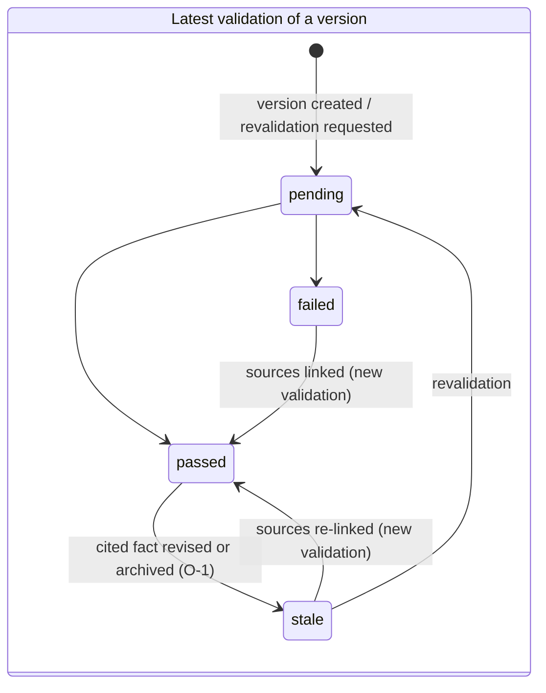
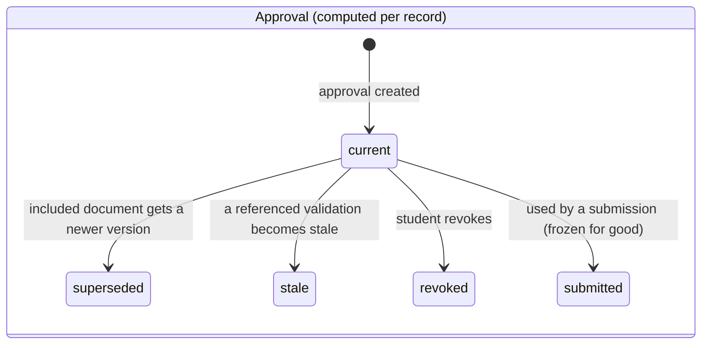
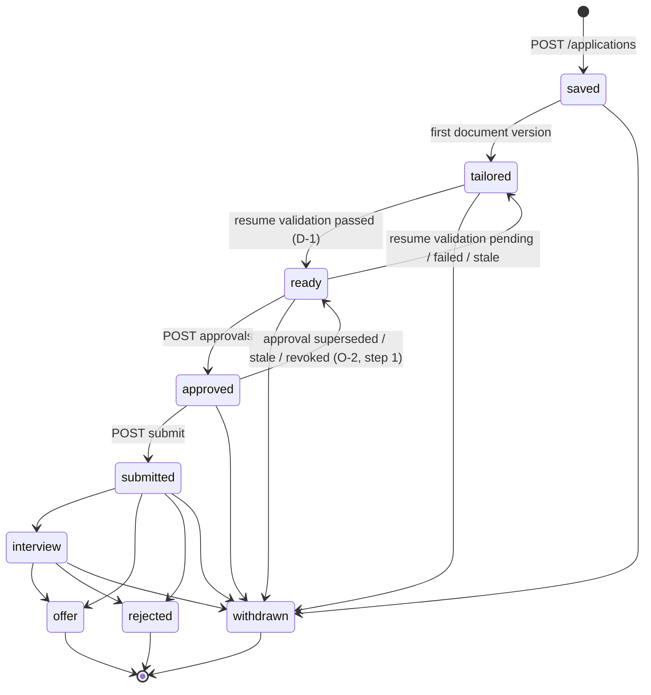

# NEXORA API Contract (v0.6)

Status: **agreed design, not yet implemented** except where marked **[implemented]**.
- **Final decisions:** D-1 to D-16, O-1 to O-9, R-3, R-4, R-8 and F-1 to F-5 (decision log, section 21).
- **Remaining questions:** R-1, R-2, R-5, R-6, R-7, R-9 and R-10 (section 22). Don't build behaviour marked [R-n] until it is answered.
- **Source of truth:** once endpoints exist, FastAPI's OpenAPI (`/api/v1/openapi.json`) wins and this file follows it.
- **Test evidence:** nothing in this contract has run against the real schema or Supabase. Tests marked **ran** in sections 17.2.2 and 18.9 were executed on 2026-11-11 on a throwaway PostgreSQL 17.11 container against simplified stand-in tables; every other test is a specification that has not been run. The throwaway SQL is not kept in the repository.

Changes from v0.5 (targeted corrections; agreed decisions and endpoint contracts are unchanged unless listed here):
- **F-1, child-row integrity (new 17.2.2):** rows in `approval_items`, `submission_items`, `evidence_validation_claims` and `evidence_claim_sources` can only be inserted by the transaction that inserted their parent, and the parent declares how many children it must have. Late inserts are rejected by the database. `evidence_validations` rows exist only once finished.
- **F-2, deletion authorization (18.1, 18.4):** the shared runtime role can set the identity setting itself, so no function it can call can safely authorize deleting a student. **MVP deletion is operator-run.** `nexora_app` can no longer execute any deletion function, the JWT-setting check is removed, and the operator verifies each request outside the runtime. The student endpoints change accordingly (section 4).
- **F-3, stalled requests (18.7):** `list_stalled_deletions` and `mark_deletion_failed` are removed. Open requests are visible to the operator only.
- **F-4, stage guard (17.4):** extended to inserts into the child tables, with a fourth invariant and regression tests G18 to G22.
- **F-5, rate limits (16, resolves R-8):** per-application edit and claim-link limits plus a per-student ceiling. Synchronous claim linking has its own limit because every call appends a full immutable validation.
- **Consistency fixes:** a validation row is created once, finished, with its children; "pending" has no row. The RLS limitation against a compromised runtime is now stated (17.2.1).

---

## 1. Conventions

| Topic | Rule |
|---|---|
| Base path | `/api/v1` |
| Auth | `Authorization: Bearer <Supabase access token>` on every endpoint except `/health*` |
| **Identity** | **The student is always the verified token's `sub`.** No body, path or query accepts `student_id`/`user_id`. |
| Ownership | Another student's resource returns **404 `NOT_FOUND`**, never 403 |
| IDs, time | UUID strings; ISO 8601 UTC (`2026-11-10T09:30:00Z`); dates `YYYY-MM-DD` |
| Naming | `snake_case`; enums are lowercase strings; nullable fields are present as `null` |
| Lists | `{ "items": [...], "next_cursor": "string\|null" }`, query `?limit=` (default 20, max 100) and `?cursor=` |
| Updates | `PATCH` with only changed fields; unknown fields → 422 |
| Long-running work | **202** with a `task` object (section 2) |
| Idempotency **[R-7]** | An optional `Idempotency-Key` header on `POST /applications`, `.../approvals`, `.../revoke`, `.../submit`, `.../transitions`, `/interviews` and `/me/deletion-requests`. Same key and body within 24 h → the original response is replayed. Same key, different body → 422 `IDEMPOTENCY_KEY_REUSED`. Duplicate prevention does not depend on the header (section 2.2). |
| Account state | A student with an open deletion request (`requested` or `data_deleted`) gets **403 `ACCOUNT_CLOSED`** from every endpoint except `/health*` and `/me/deletion-requests*` (section 18.2, R-6) |
| Test data | Fixtures and the shared development project contain **synthetic data only** |

### 1.1 Error format **[implemented]**

```json
{ "error": { "code": "APPLICATION_EXISTS", "message": "You already saved this job.",
             "details": [ { "application_id": "a12b..." } ] } }
```

| HTTP | `code` | Meaning |
|---|---|---|
| 401 | `UNAUTHENTICATED` | Missing, invalid, expired, anonymous or deleted-user token. One generic message. |
| 403 | `CONSENT_REQUIRED` | Required consent not granted (`details`: `[{"consent_type": "..."}]`) |
| 403 | `ACCOUNT_CLOSED` | An open deletion request exists for this account; it ends if the operator rejects the request (section 18.2) |
| 404 | `NOT_FOUND` | Missing or not owned |
| 409 | `APPLICATION_EXISTS` | An **active** (non-withdrawn) application for this job exists (`details`: `[{"application_id": "..."}]`) |
| 409 | `VERSION_CONFLICT` | `base_version` is not current |
| 409 | `INVALID_TRANSITION` | Application stage change not allowed |
| 409 | `DOCUMENT_LOCKED` | Not allowed now. `details`: `[{"reason": "stage"}]` (locked stage) or `[{"reason": "current_approval"}]` (version is in the current approval) |
| 409 | `JOB_DESCRIPTION_REQUIRED` | Document generation for a manual application without `job_description` (R-1) |
| 409 | `TASK_IN_PROGRESS` | Same task kind already running for this resource (`details`: `[{"task_id": "..."}]`) |
| 409 | `TASK_NOT_RETRYABLE` | Retrying a task that isn't `failed` with `retryable: true` |
| 409 | `REQUIRED_DOCUMENT_MISSING` | Approval without a resume |
| 409 | `UNSUPPORTED_CLAIMS` | An included version has unsupported claims (`details`: claim IDs) |
| 409 | `VALIDATION_PENDING` | An included version has no finished validation |
| 409 | `VALIDATION_STALE` | Referenced validation is not the latest, or a cited fact was revised or archived since |
| 409 | `APPROVAL_STALE` | Referenced version is no longer current |
| 409 | `APPROVAL_NOT_CURRENT` | Revoking an approval that is not current |
| 409 | `APPROVAL_REQUIRED` | Submit without a current approval (including after revocation) |
| 409 | `FACT_IN_USE` | Hard delete of a fact that has been cited (use archive) |
| 409 | `FACT_ARCHIVED` | Editing or citing an archived fact |
| 413 | `FILE_TOO_LARGE` | Upload > 5 MB |
| 415 | `UNSUPPORTED_FILE_TYPE` | Not PDF/DOCX (content-checked) |
| 422 | `VALIDATION_ERROR` | `details` = `[{loc, msg, type}]` **[implemented]** |
| 422 | `IDEMPOTENCY_KEY_REUSED` | Same `Idempotency-Key` with a different request body **[R-7]** |
| 429 | `RATE_LIMITED` | A per-student or per-application hourly limit (task limits, edit and claim-link limits), or the resume-parse concurrency cap (sections 5, 16 and 16.1); `Retry-After` header; `details` names the limit |
| 503 | `DB_UNAVAILABLE` | Database unreachable **[implemented on `/health/db`]** |
| 500 | `INTERNAL_ERROR` | No internal detail leaked **[implemented]** |

---

## 2. Long-running tasks

These operations run as tasks with FastAPI BackgroundTasks. Every task has a `trigger`:

| Operation | Task kind | `trigger` |
|---|---|---|
| Resume parsing | `resume_parse` | `explicit` |
| Job refresh | `job_refresh` | `explicit` |
| Document generation | `document_generation` | `explicit` |
| Evidence validation | `evidence_validation` | `automatic` (created with a new version) or `explicit` (`POST .../validations`) |
| Question generation | `question_generation` | `explicit` |
| Answer evaluation | `answer_evaluation` | `explicit` |

Account deletion is not a task. It has its own resource and status (section 18).

| Method | Path | Purpose |
|---|---|---|
| GET | `/tasks/{task_id}` | Poll one task |
| GET | `/tasks?status=&kind=` | List own tasks |
| POST | `/tasks/{task_id}/retry` | Retry a failed task with `retryable: true`. 202 with a new task row; otherwise 409 `TASK_NOT_RETRYABLE` |

```json
{
  "id": "6f1c...", "kind": "document_generation", "status": "failed", "trigger": "explicit",
  "resource": { "type": "application", "id": "a12b..." }, "attempt": 1, "retry_of": null,
  "error": { "code": "AI_TIMEOUT", "message": "Generation took too long. Try again.", "retryable": true },
  "timeout_seconds": 90,
  "created_at": "2026-11-10T09:30:00Z", "started_at": "2026-11-10T09:30:01Z", "finished_at": "2026-11-10T09:31:31Z"
}
```

| Field | Values |
|---|---|
| `status` | `queued → running → succeeded \| failed` (terminal) |
| `trigger` | `explicit` or `automatic`. A retry inherits it. It decides what counts toward rate limits (section 16). |
| `retry_of` | ID of the failed task this one retries, or `null` |
| `timeout_seconds` | From configuration (section 16) |

| `error.code` | `retryable` | Meaning |
|---|---|---|
| `AI_UNAVAILABLE` | true | Provider down and no mock configured |
| `AI_TIMEOUT` | true | Exceeded `timeout_seconds` (any task kind; set by the runner or the watchdog) |
| `AI_INVALID_OUTPUT` | true | Output failed schema validation |
| `SOURCE_UNAVAILABLE` | true | Job source unreachable |
| `TASK_INTERRUPTED` | true (false for `resume_parse`) | The server restarted, or the task never started within its timeout (section 2.1) |
| `PARSE_FAILED` | false | File unreadable |
| `INTERNAL_ERROR` | false | Unexpected |

**`resume_parse` is never retryable** (`retryable: false` for every error code), because the uploaded file is not kept (section 5). The student uploads again.

Client rules:
- Poll every 2 s, honour `Retry-After`, and stop at a terminal status.
- Offer retry only when `retryable` is true.

Server rules:
- At most one non-terminal task per `(kind, resource)`; a second request → 409 `TASK_IN_PROGRESS`.
- No automatic retries. Recovery only marks tasks failed (section 2.1).
- Task creation is rate-limited per section 16; a 429 creates no task.

### 2.1 State changes, startup recovery and watchdog

BackgroundTasks keep their queue only in memory, so a restart loses every task that has not finished. The backend therefore cleans up in three places, and a task can never stay `queued` or `running` permanently.

1. **Compare-and-set (CAS) transitions.** Every state change is one SQL statement with the expected current state in its `WHERE` clause. The runner proceeds only when exactly one row was updated:
   - start: `UPDATE tasks SET status='running', started_at=now() WHERE id=:id AND status='queued'`;
   - completion: `UPDATE tasks SET status='succeeded', finished_at=now() WHERE id=:id AND status='running'`, **in the same transaction as the result records**. If it updates 0 rows, the whole transaction rolls back;
   - failure: `UPDATE tasks SET status='failed', error_code=:code, retryable=:r, finished_at=now() WHERE id=:id AND status IN ('queued','running')`.
2. **Startup recovery.** In the application lifespan, before the first request is served, the backend calls `nexora_private.recover_tasks(false)` (section 18.7). Every task that is `queued` **or** `running` becomes `failed` with `TASK_INTERRUPTED`, `retryable = (kind <> 'resume_parse')`, and `finished_at = now()`. After a restart neither state can still be live. The count is logged. If the database is unreachable at startup, the app still starts (health stays up), logs a warning, and the watchdog does the recovery on its first successful run.
3. **Watchdog.** Every `TASK_WATCHDOG_INTERVAL_SECONDS` (60) the backend calls `recover_tasks(true)`. A non-terminal task whose age exceeds `timeout_seconds + TASK_WATCHDOG_GRACE_SECONDS` (30) is failed:
   - age is measured from `started_at`, or from `created_at` if it never started;
   - code `AI_TIMEOUT` if it started, `TASK_INTERRUPTED` if it never did.
4. **Normal timeouts.** The runner wraps the work in `asyncio.wait_for(timeout_seconds)`. On timeout it rolls back and fails the task through the failure CAS (`AI_TIMEOUT`).
5. **No zombie commits.** A coroutine whose task was failed by recovery or the watchdog cannot commit a result, because its completion CAS updates 0 rows and its transaction rolls back. Combined with the `task_id` uniqueness in 2.2, a retry cannot produce a second result.

Worst case, a hung task shows as non-terminal for `timeout_seconds + 30` s. After a restart it is cleared immediately.

> **shortcut: single backend instance.** Recovery fails every non-terminal task, which is only correct with one backend process. Before running more than one instance, add `locked_by` and `heartbeat_at` to `tasks` and let recovery fail only tasks whose heartbeat is older than the grace period.

### 2.2 Retries and duplicate side effects

A retry creates a **new** task row (`retry_of` = the failed task, `attempt` + 1, same `trigger` and resource). The failed task never committed results (rules 1 and 5), so nothing it did can be repeated. Preconditions are checked again on retry (for example a locked stage → 409 `DOCUMENT_LOCKED`), and a non-terminal task for the same `(kind, resource)` → 409 `TASK_IN_PROGRESS`.

Duplicates are prevented by database constraints, not by client behaviour:

| Operation | Guard |
|---|---|
| `document_generation` | `document_versions.task_id` unique (partial, when not null). The version number is assigned while holding `SELECT ... FOR UPDATE` on the `documents` row, with `UNIQUE (document_id, version)`. Completion CAS. |
| `evidence_validation` | `evidence_validations.task_id` unique (partial); completion CAS |
| `resume_parse` | Completion CAS. Never retried (the file is gone). |
| `job_refresh` | Jobs are upserted on `UNIQUE (source, source_job_id)` |
| `question_generation` | `interview_sessions.question_task_id` unique; `UNIQUE (session_id, question_order)` |
| `answer_evaluation` | `UNIQUE (question_id)` on evaluations |
| Approval | Stage CAS in the transaction: `UPDATE applications SET stage='approved' WHERE id=:id AND stage='ready'` |
| Revocation | `UNIQUE (approval_id)` on revocations |
| **Submission** | `UNIQUE (application_id)` and `UNIQUE (approval_id)` on submissions, plus stage CAS `approved → submitted` |
| Save job | Partial unique index (section 17.3) |

A client repeating a request (double click, network retry) gets 409 from these guards. If it sends an `Idempotency-Key`, it gets the original response instead (section 1, R-7). The guards do not depend on that header.

---

## 3. Lifecycles (kept separate)

### 3.1 Document lifecycle (per version)

A document has `kind` `resume` (**required** for approval) or `cover_note` (**optional**). Versions are numbered and **immutable**. Each version has a validation history; the latest validation is the one that counts.





- **Never modified:** validation, approval, revocation and submission records. No application code path or runtime credential can change them; the migration owner and platform administrators technically can (section 17.2.1). Each status is computed from the records that exist.
- **Rows exist only when finished.** A validation row is inserted once, already `passed` or `failed`, together with all its claims and sources in one transaction (section 17.2.2). `pending` means the validation task has not finished, so there is no row yet; `stale` is computed. An approval row is likewise inserted with all its items at once.
- **Staleness:** a stale validation is never treated as passed. Staleness only has effects **before submission** (section 11.1).
- **Frozen approvals:** `submitted` is terminal. An approval used by a submission never becomes stale, superseded or revoked.

### 3.2 Application lifecycle



| From | To | Actor | Trigger |
|---|---|---|---|
| (new) | saved | student | `POST /applications` (job or manual) |
| saved | tailored | system | First version of any document created |
| tailored | ready | system | **D-1:** the resume's current version has a latest validation that is `passed` and not stale |
| ready | tailored | system | That condition stops being true (new resume version, failed validation, or a cited fact revised or archived) |
| ready | approved | student | `POST .../approvals` only |
| approved | ready | system | The current approval becomes `superseded`, `stale` or `revoked`. **Always followed by the D-1 check (section 3.4).** |
| approved | submitted | student | `POST .../submit` only |
| submitted | interview, offer, rejected | student | `POST .../transitions` |
| interview | offer, rejected | student | `POST .../transitions` |
| saved, tailored, ready, approved, submitted, interview | withdrawn | student | `POST .../transitions` with `to: "withdrawn"` |

- All other changes → 409 `INVALID_TRANSITION`.
- `offer`, `rejected` and `withdrawn` are terminal.
- No stage change deletes any record.
- A failing optional `cover_note` never moves the stage. It only can't be included in an approval.

### 3.3 D-1 guarantee: `ready` and `approved` require a passing resume

An application can be in `ready` or `approved` **only if** the resume's current version has a latest validation that is `passed` with 0 unsupported claims and is not stale.
- For `approved`, the application's current approval must also be `current`.
- The service layer enforces this in every transaction in section 3.6, and a DB constraint trigger enforces it as well (section 17.4).

| Cause | Resume validation becomes | Required stage effect (same transaction) |
|---|---|---|
| New resume version (generated or edited) | `pending` | `ready → tailored`; or `approved → ready → tailored` if the version was approved |
| Validation finishes `failed` | `failed` | none (already `tailored`) |
| Validation finishes `passed` | `passed` | `tailored → ready` |
| Cited fact revised (`PATCH`) | `stale` | `ready → tailored`; or `approved → ready → tailored` |
| Cited fact archived | `stale` (O-1) | same as revised |
| Sources linked with a new passing validation | `passed` | `tailored → ready` |
| Revocation (resume still passing) | `passed` | `approved → ready` only |

### 3.4 Invalidation sequence (O-2)

When the current approval ends:
1. **Step 1:** record `approved → ready` (reason `approval_superseded`, `approval_stale` or `approval_revoked`), as the PRD requires.
2. **Step 2, in the same transaction:** if the resume's latest validation is `pending`, `failed` or `stale`, record `ready → tailored` (reason `validation_not_passed`).
3. `applications.stage` is written once, with the final value.

Both events carry the same `transaction_id` and increasing `sequence`. If anything fails, nothing commits: not the cause, the events nor the stage.

`GET .../events` after an approved resume is edited:
```json
{ "items": [
  { "id": "e07...", "sequence": 41, "transaction_id": "tx-9a1...", "from_stage": "approved", "to_stage": "ready",
    "actor": "system", "reason": "approval_superseded",
    "related": { "approval_id": "ap4...", "document_id": "doc1...", "version": 7 }, "created_at": "2026-11-12T08:00:00Z" },
  { "id": "e08...", "sequence": 42, "transaction_id": "tx-9a1...", "from_stage": "ready", "to_stage": "tailored",
    "actor": "system", "reason": "validation_not_passed",
    "related": { "document_id": "doc1...", "version": 7, "validation_status": "pending" }, "created_at": "2026-11-12T08:00:00Z" }
], "next_cursor": null }
```

### 3.5 Document generation and editing by stage

| Stage | Generate / edit / link / revalidate? | Read |
|---|---|---|
| saved, tailored, ready | yes | yes |
| approved | yes, except link and revalidate on versions in the current approval (409 `DOCUMENT_LOCKED`, `current_approval`). Editing an included document supersedes the approval. | yes |
| submitted, interview, offer, rejected | **no** → 409 `DOCUMENT_LOCKED` (`stage`). D-6: post-submission versioning is deferred. | yes |
| withdrawn | **no** → 409 `DOCUMENT_LOCKED` (`stage`) (O-9) | yes: documents, versions, evidence and validations stay readable |

### 3.6 Transaction rules

Every row below is **one database transaction**:
- It locks the affected `applications` rows with `SELECT ... FOR UPDATE` in ascending `id` order, which prevents deadlocks.
- It writes the records listed.
- It inserts one event per stage change, all sharing the transaction's `transaction_id`.
- It writes the final stage.

If any step fails, everything rolls back. A task-result transaction also performs the compare-and-set of section 2.1, so a task that was already failed by recovery or the watchdog can never commit.

| Action | Records written | Possible stage events |
|---|---|---|
| Save job / manual application | application; event; deadline reminder if `deadline` is set | (new) → saved |
| Generation task completes | document (first time), version, validation task (no validation row yet: `pending` is derived), task status | saved → tailored; per section 3.3 |
| Student edits a document (after the edit-limit check, 16.1) | version, validation task | per section 3.3 / 3.4 |
| Validation task completes | validation **with all its claims and sources in this one transaction** (17.2.2), task status | tailored → ready if the resume now passes. If the version is no longer current, the validation is stored with no stage effect. |
| Link claim sources (after the link-limit check, 16.1) | new validation (synchronous) with all its claims and sources | tailored → ready if the resume now passes |
| Fact revised | fact row (`revision + 1`), revision record | for every affected **pre-submission** application: per section 3.3 / 3.4 |
| Fact archived | fact row (`status`, `archived_at`) | same as fact revised |
| Approval | approval **with all its items in this one transaction** (17.2.2); `current_approval_id` | ready → approved |
| Revocation | revocation record; clear `current_approval_id` | approved → ready, then the D-1 check |
| Submission | submission **with all its items in this one transaction** (17.2.2); `submitted_at` | approved → submitted |
| Student transition (outcomes, withdraw) | event | per section 3.2 |

---

## 4. Authentication and profile

Sign-up, sign-in, sign-out and token refresh happen in the frontend with Supabase Auth. Signed-out access tokens stay valid until they expire, which is 15 minutes at most (D-14, O-7).

| Method | Path | Purpose |
|---|---|---|
| GET | `/health`, `/health/db` | Liveness / DB check, no auth **[implemented]** |
| GET | `/profile/me` | Own profile; created on first call **[implemented]** |
| PATCH | `/profile/me` | Update academic fields and `eligible_locations` |
| GET / PUT | `/profile/me/preferences` | Target roles, locations, work modes (fit only) |
| GET | `/profile/me/consents` | All consent states |
| PUT | `/profile/me/consents/{consent_type}` | Grant or withdraw |
| GET / POST | `/profile/facts` | List (`?type=&status=`; archived excluded unless `status=archived`) / add |
| PATCH | `/profile/facts/{fact_id}` | Edit → new revision |
| POST | `/profile/facts/{fact_id}/archive` | Archive |
| DELETE | `/profile/facts/{fact_id}` | Hard delete, **only if never cited** |
| GET | `/profile/facts/{fact_id}/revisions` | Revision history |
| POST | `/profile/facts/confirm` | Confirm extracted facts in bulk |
| POST | `/me/deletion-requests` | Request deletion (202). **Deletes nothing:** it records the request and closes the account; an operator verifies and executes it (section 18) |
| GET | `/me/deletion-requests/{id}` | Status of the caller's own request (available until the login itself is removed) |

`PATCH /profile/me`
```json
{ "batch_year": 2027, "cgpa": "8.40", "backlogs": 0, "branch": "CSE", "eligible_locations": ["Bengaluru", "Hyderabad"] }
```
Response 200 (fields marked **[implemented]** exist today; `eligible_locations` needs a migration):
```json
{ "id": "1111...", "email": "a@example.com", "full_name": "Asha Rao", "batch_year": 2027, "cgpa": "8.40",
  "backlogs": 0, "branch": "CSE", "eligible_locations": ["Bengaluru", "Hyderabad"],
  "created_at": "2026-11-10T09:00:00Z", "updated_at": "2026-11-10T09:31:00Z" }
```

Rules:
- `id` and `email` are read-only.
- `cgpa` is a decimal string from 0 to 10, `batch_year` is 2000–2100, and `backlogs` is at least 0.
- **`eligible_locations` (O-5)** lists the locations where the student can work. The student maintains it; it is never inferred from preferences.
  - It is `null` (not provided) or a list of 1–20 strings, 1–100 characters each.
  - An empty list → 422.
  - It is used only against explicit employer location restrictions (section 6).

`PUT /profile/me/preferences` (fit scoring only, never eligibility):
```json
{ "target_roles": ["Backend Engineer"], "locations": ["Bengaluru", "Remote"],
  "work_modes": ["remote", "hybrid"], "employment_types": ["full_time", "internship"] }
```

`PUT /profile/me/consents/resume_processing`
```json
{ "granted": true }
```
Response: `{ "consent_type": "resume_processing", "granted": true, "granted_at": "...", "withdrawn_at": null }`.

| `consent_type` | Effect |
|---|---|
| `resume_processing` | Required before `POST /resumes` |
| `retain_resume_file` | **Reserved.** Rejected with 422 until Storage exists (section 5) |

**Profile fact**: the only source of truth for generated content.

`POST /profile/facts`
```json
{ "type": "project", "data": { "title": "Inventory API", "description": "REST API for stock tracking",
  "technologies": ["FastAPI", "PostgreSQL"], "url": null, "start_date": "2026-01-01", "end_date": "2026-03-01" } }
```
Response 201:
```json
{ "id": "f001...", "type": "project", "data": { "...": "as sent" }, "status": "confirmed", "source": "student",
  "revision": 1, "ever_cited": false, "confidence": null, "source_ref": null,
  "archived_at": null, "created_at": "...", "updated_at": "..." }
```

| `type` | `data` fields |
|---|---|
| `education` | `institution`, `degree`, `field`, `start_date`, `end_date`, `grade` |
| `skill` | `name`, `level` (`beginner\|intermediate\|advanced\|null`) |
| `project` | `title`, `description`, `technologies[]`, `url`, `start_date`, `end_date` |
| `experience` | `organization`, `title`, `description`, `start_date`, `end_date` |
| `achievement` | `title`, `description`, `date` |
| `certification` | `name`, `issuer`, `date`, `url` |

| `status` | Meaning |
|---|---|
| `pending_confirmation` | Extracted from a resume; not yet citable |
| `confirmed` | Citable as evidence |
| `archived` | Terminal: cannot be edited, cited by a new claim, or linked |

Fact rules:
- **Confirmation:** a manually added fact is `confirmed` on creation.
- **Revisions:** every `PATCH` creates a new immutable revision. `GET .../revisions` returns `[{ "revision": 1, "data": {...}, "created_at": "..." }]`.
- **Editing a cited fact (D-7):** validations citing an older revision become `stale`, and the stage effects of sections 3.3 and 3.6 follow.
- **Archiving a cited fact (O-1):**
  - every **pre-submission** validation citing the fact becomes `stale`;
  - approvals depending on those validations become `stale`;
  - stage effects follow;
  - submitted snapshots are unaffected (section 11.1);
  - revisions and provenance stay, and there is no unarchive in the MVP.
- **`DELETE`:** 204 only if `ever_cited` is false; otherwise 409 `FACT_IN_USE` (use archive).

`POST /profile/facts/f001.../archive` → 200:
```json
{ "id": "f001...", "status": "archived", "revision": 3, "archived_at": "2026-11-12T09:00:00Z",
  "affected": { "stale_validation_ids": ["v09..."], "applications": [ { "id": "a12b...", "stage": "tailored" } ] } }
```

`POST /profile/facts/confirm`
```json
{ "fact_ids": ["f002...", "f003..."] }
```
Response: `{ "confirmed": ["f002...", "f003..."] }`.

`POST /me/deletion-requests`
```json
{ "confirm": "DELETE MY DATA" }
```
Response 202:
```json
{ "id": "d01...", "status": "requested", "requested_at": "2026-11-12T09:00:00Z",
  "data_deleted_at": null, "account_removal": "pending" }
```
`status` is `requested`, `data_deleted` or `rejected`. Both the data deletion and the removal of the student's **login** are manual operator steps (F-2, R-3, section 18.6), after the operator has verified the request outside the app. If an open request already exists, the call returns it with 200. The threat model, retained records and tests are in section 18.

---

## 5. Resume upload and parsing

**MVP: uploaded files are never stored (R-3).** The backend reads the upload into memory, parses it in a task, and discards the bytes. Nothing is written to disk, a temp directory or Storage. Only metadata and the extracted facts are saved.

| Method | Path | Purpose |
|---|---|---|
| POST | `/resumes` | Upload, `multipart/form-data`: `file` only. 202 |
| GET | `/resumes`, `/resumes/{resume_id}` | List / detail (metadata only) |
| DELETE | `/resumes/{resume_id}` | Delete the metadata row (extracted facts stay) |

Response 202:
```json
{
  "resume": { "id": "r01...", "filename": "asha_resume.pdf", "content_type": "application/pdf",
              "size_bytes": 182233, "extracted_fact_count": null, "created_at": "..." },
  "task": { "id": "t01...", "kind": "resume_parse", "status": "queued", "trigger": "explicit",
            "resource": { "type": "resume", "id": "r01..." }, "attempt": 1, "retry_of": null, "error": null,
            "timeout_seconds": 60, "created_at": "...", "started_at": null, "finished_at": null }
}
```

Preconditions:
- Consent `resume_processing` is granted (else 403 `CONSENT_REQUIRED`).
- The file is 5 MB or less (else 413). The size is enforced while streaming, before the whole file is buffered.
- The file is PDF or DOCX, checked by its magic bytes (else 415).
- The student is within 10 parses per hour (else 429).
- Fewer than `RESUME_PARSE_MAX_CONCURRENCY` (2) parses are running or queued in this backend process; otherwise 429 `RATE_LIMITED` with `Retry-After`. This bounds memory use.

On success:
- Extracted facts are stored with `status: pending_confirmation`, plus `confidence` and `source_ref` (`{ "resume_id", "page", "excerpt" }`).
- The resume row keeps only `filename` (sanitized for display), `content_type` and `size_bytes`. It has no storage path.

Because the file is not kept:
- A failed or interrupted parse cannot be retried. The task has `retryable: false` and the student uploads again.
- The consent `retain_resume_file` and any retention option are **not available**. `PUT /profile/me/consents/retain_resume_file` → 422.

**Deferred: private Storage (possible later).** The design leaves room for it without changing today's contract:
- a nullable `resumes.storage_path`, and a private bucket with no public URLs;
- download only through short-lived signed URLs created for the owner;
- uploads either under Storage RLS using the student's own access token, or through a backend-only key. Which of these to use is decided when it is built.
- The `retain_resume_file` consent type is reserved for that.

---

## 6. Jobs and eligibility

| Method | Path | Purpose |
|---|---|---|
| POST | `/jobs/refresh` | Fetch sources, recompute eligibility and fit. 202 task `job_refresh` |
| GET | `/jobs/recommended?limit=5` | Top **eligible** jobs by fit (default 5) |
| GET | `/jobs/excluded?status=ineligible\|unknown` | Jobs not ranked, with reasons |
| GET | `/jobs/{job_id}` | Listing plus my eligibility and fit |
| POST / DELETE | `/jobs/{job_id}/dismiss` | Hide / unhide |

Saving a job = `POST /applications` (section 11). For the MVP, `source` is `mock` (D-11).

**Job** (normalized):
```json
{
  "id": "j01...", "source": "mock", "source_job_id": "MOCK-42",
  "title": "Backend Engineer Intern", "company": "Acme", "location": "Bengaluru",
  "work_mode": "hybrid", "employment_type": "internship", "description": "...",
  "requirements": {
    "skills_required": ["Python", "SQL"], "skills_preferred": ["FastAPI"], "experience_years_min": 0,
    "min_cgpa": "7.50", "max_backlogs": 0, "batch_years": [2026, 2027], "branches": ["CSE", "IT"],
    "location_restriction": ["Bengaluru", "Pune"]
  },
  "apply_url": "https://example.com/jobs/42", "deadline": "2026-12-01",
  "posted_at": "...", "fetched_at": "...", "is_stale": false
}
```

Location fields:
- `location` is where the job is. It only affects **fit** (compared with preferences).
- `requirements.location_restriction` is `null`, or the employer's explicit list of allowed candidate locations. Adapters set it only when the listing states the restriction explicitly. It is a **hard filter**.

**Eligibility (D-9: strict hard filters, before fit)**
```json
{
  "job": { "id": "j02...", "title": "SDE 1", "company": "Beta", "...": "..." },
  "eligibility": {
    "status": "ineligible",
    "reasons": [
      { "code": "CGPA_BELOW_MINIMUM", "criterion": "min_cgpa", "required": "7.50", "actual": "7.20",
        "message": "Your CGPA 7.20 is below the minimum 7.50." },
      { "code": "LOCATION_RESTRICTED", "criterion": "location_restriction", "required": ["Bengaluru", "Pune"],
        "actual": ["Hyderabad"], "message": "This role only accepts candidates who can work in Bengaluru or Pune." }
    ],
    "evaluated_at": "...", "rules_version": "eligibility-v1"
  }
}
```
```json
{
  "job": { "id": "j03...", "...": "..." },
  "eligibility": {
    "status": "unknown",
    "reasons": [ { "code": "PROFILE_FIELD_MISSING", "criterion": "location_restriction", "required": ["Bengaluru"],
                   "actual": null, "field": "eligible_locations",
                   "message": "Add the locations where you can work to check eligibility for this role." } ],
    "evaluated_at": "...", "rules_version": "eligibility-v1"
  }
}
```

| `status` | Rule |
|---|---|
| `eligible` | Every criterion the job specifies passes. Unspecified criteria aren't applied. |
| `ineligible` | At least one specified criterion fails. All failures are returned, plus any missing-field reasons. |
| `unknown` | No failure, but at least one specified criterion can't be checked because a student field is missing. **Never eligible**, never ranked or scored. |

| `code` | Criterion | Fails when | Student field |
|---|---|---|---|
| `BATCH_YEAR_NOT_ELIGIBLE` | `batch_years` | `batch_year` not in list | `batch_year` |
| `BRANCH_NOT_ELIGIBLE` | `branches` | normalized `branch` not in normalized list | `branch` |
| `CGPA_BELOW_MINIMUM` | `min_cgpa` | `cgpa < min_cgpa` (decimal compare) | `cgpa` |
| `BACKLOGS_ABOVE_MAXIMUM` | `max_backlogs` | `backlogs > max_backlogs` | `backlogs` |
| `LOCATION_RESTRICTED` | `location_restriction` | no normalized `eligible_locations` entry equals a normalized restriction entry | `eligible_locations` |
| `PROFILE_FIELD_MISSING` | any | the student field is `null` | as above |

**Normalization:**
- Apply Unicode NFKC, trim, collapse whitespace, and casefold. Then compare for exact equality.
- No synonyms ("CS" ≠ "CSE"; "Bangalore" ≠ "Bengaluru").
- Adapters output canonical values. The frontend should offer the canonical location list used by the fixtures.

---

## 7. Fit scoring

`GET /jobs/{job_id}/match` (job-based applications and listings only; never for manual applications):
```json
{
  "job_id": "j01...",
  "eligibility": { "status": "eligible", "reasons": [], "evaluated_at": "...", "rules_version": "eligibility-v1" },
  "fit": {
    "score": 78,
    "sub_scores": { "skills": 82, "experience": 60, "location": 100, "preferences": 75 },
    "weights": { "skills": 0.5, "experience": 0.2, "location": 0.15, "preferences": 0.15 },
    "matched_requirements": [ { "requirement": "Python", "kind": "skill_required", "fact_ids": ["f010..."] } ],
    "missing_requirements": [ { "requirement": "Docker", "kind": "skill_preferred" } ],
    "reasons": ["Matches 2 of 2 required skills.", "Job location Bengaluru is in your preferred locations."]
  },
  "scoring_version": "fit-v1", "scored_at": "..."
}
```

Scoring rules:
- `fit` is `null` unless the job is `eligible`.
- The location sub-score uses preferences, not `eligible_locations`.
- `fact_ids` reference confirmed, non-archived facts.
- The scorer never receives name, gender, photo or college tier.

`GET /jobs/recommended` item: `{ "job": Job, "fit_score": 78, "top_matched": ["Python"], "top_missing": ["Docker"] }`.

---

## 8. Documents and versions

| Method | Path | Purpose |
|---|---|---|
| POST | `/applications/{application_id}/documents/generate` | Generate. 202 task `document_generation` |
| GET | `/applications/{application_id}/documents` | Documents for an application |
| GET | `/documents/{document_id}` | Document plus current version summary |
| GET | `/documents/{document_id}/versions` | Version list |
| GET | `/documents/{document_id}/versions/{version}` | One version |
| POST | `/documents/{document_id}/versions` | Student edit → **new** version (201) and a validation task |
| GET | `/documents/{document_id}/versions/{version}/export?format=pdf` | **Deferred until all Must flows work (D-12).** Not registered before that. |

`POST /applications/a12b.../documents/generate`
```json
{ "kinds": ["resume", "cover_note"] }
```
Response 202:
```json
{ "documents": [ { "id": "doc1...", "kind": "resume", "required": true, "current_version": null },
                 { "id": "doc2...", "kind": "cover_note", "required": false, "current_version": null } ],
  "task": { "id": "t02...", "kind": "document_generation", "status": "queued", "timeout_seconds": 90, "...": "..." } }
```

Generation rules:
- **Kinds:** at least one, each at most once. One document per kind per application; regenerating adds a version.
- **Facts:** confirmed, non-archived facts only. The cover note is 120–180 words.
- **Limits:** 10 generations per student per hour, retries included.
- **Locked stages:** 409 `DOCUMENT_LOCKED` (section 3.5).
- **Job input:**
  - Job-based applications use the normalized job.
  - Manual applications use their `job_description` (O-4). Without one → 409 `JOB_DESCRIPTION_REQUIRED` (R-1).
  - Requirements are never invented.

`GET /documents/doc1.../versions/4`
```json
{
  "document_id": "doc1...", "kind": "resume", "required": true, "version": 4,
  "origin": "student_edit", "based_on_version": 3,
  "content": { "sections": [ { "id": "s1", "heading": "Projects", "blocks": [
      { "id": "b1", "sentences": [ { "id": "c1", "text": "Built an inventory REST API with FastAPI and PostgreSQL." } ] } ] } ] },
  "content_sha256": "9f2c...",
  "validation": { "id": "v07...", "status": "passed",
                  "summary": { "total_claims": 12, "supported": 12, "unsupported": 0 }, "is_stale": false },
  "approvals": [ { "approval_id": "ap3...", "status": "current" } ],
  "submission_ids": [],
  "created_at": "..."
}
```

`POST /documents/doc1.../versions` (edit)
```json
{ "base_version": 4, "content": { "sections": [ "...full content..." ] } }
```
Response 201: version 5 with `validation.status: "pending"` and `"validation_task_id": "t03..."`.

Edit errors:
- A stale `base_version` → 409 `VERSION_CONFLICT`.
- A locked stage → 409 `DOCUMENT_LOCKED`.
- Over the edit limits (section 16.1) → 429 `RATE_LIMITED`; no version, validation or task is created.

---

## 9. Evidence Ledger and validation

| Method | Path | Purpose |
|---|---|---|
| GET | `/documents/{document_id}/versions/{version}/evidence` | Claims, sources, latest validation |
| PUT | `/documents/{document_id}/versions/{version}/claims/{claim_id}/sources` | Link a claim to facts; new validation, synchronous |
| POST | `/documents/{document_id}/versions/{version}/validations` | **Explicit** revalidation (for example after staleness). 202 task `evidence_validation`, `trigger: "explicit"`, limited to 30 per student per hour (R-4). The validation created automatically with a new version is separate and not limited. |
| GET | `/documents/{document_id}/versions/{version}/validations` | Validation history |

`GET .../versions/5/evidence`
```json
{
  "document_id": "doc1...", "version": 5,
  "validation": { "id": "v08...", "status": "failed", "summary": { "total_claims": 12, "supported": 11, "unsupported": 1 },
                  "is_stale": false, "stale_causes": [], "validator_version": "evidence-v1", "created_at": "..." },
  "claims": [
    { "id": "cl1...", "sentence_id": "c1", "text": "Built an inventory REST API with FastAPI and PostgreSQL.",
      "status": "supported",
      "sources": [ { "fact_id": "f001...", "fact_revision": 1, "fact_type": "project",
                     "fact_status": "confirmed", "excerpt": "Inventory API (FastAPI, PostgreSQL)" } ] },
    { "id": "cl2...", "sentence_id": "c7", "text": "Led a team of five engineers.", "status": "unsupported", "sources": [] }
  ]
}
```

`stale_causes` example: `[ { "fact_id": "f001...", "cited_revision": 1, "current_revision": 2, "archived": false } ]`.

`PUT .../claims/cl2.../sources`
```json
{ "fact_ids": ["f020..."] }
```
Response 200: the new validation. It records each fact's **current** revision. No AI is called, but **every call appends a complete immutable validation** (the validation, every claim and every source), so it has its own limit (section 16.1).

| The link is rejected when | Error |
|---|---|
| A fact is archived | 409 `FACT_ARCHIVED` |
| A fact is not the student's own | 422 |
| A fact is `pending_confirmation` | 422 |
| The version is in the application's current approval | 409 `DOCUMENT_LOCKED` (`current_approval`); revoke first |
| The stage is locked | 409 `DOCUMENT_LOCKED` (`stage`) |
| The per-application link limit (120/hour) or the per-student ceiling (300/hour) is reached | 429 `RATE_LIMITED`; no validation is created |

**Evidence rules (enforced by the backend):**
1. Every sentence is a claim.
2. **Supported claims:** a claim is `supported` only if it has at least one source whose fact is the student's own, `confirmed` and not archived, at the revision recorded.
3. **AI proposals:** AI modules only *propose* `fact_ids`. The backend drops unknown, foreign, unconfirmed or archived facts.
4. **Staleness:** a validation is `stale` when any cited fact has a newer revision or is archived. Staleness only affects pre-submission applications (section 11.1).
5. **Immutability:** sources are stored per validation, so a new link or revalidation never changes an earlier validation.

---

## 10. Approval workflow

| Method | Path | Purpose |
|---|---|---|
| GET | `/applications/{application_id}/approval-check` | What can be approved and what blocks it |
| POST | `/applications/{application_id}/approvals` | Explicit student approval |
| GET | `/applications/{application_id}/approvals` | History, including revocations (append-only) |
| POST | `/applications/{application_id}/approvals/{approval_id}/revoke` | Explicit revocation (D-8) |

**Required and included documents (D-5)**

| Rule | Detail |
|---|---|
| Required | The `resume` must be in `items` (else 409 `REQUIRED_DOCUMENT_MISSING`) |
| Optional | `cover_note` may be included or left out, even when it exists |
| Included = validated | Every item references its document's current version and that version's latest, non-stale, `passed` validation with 0 unsupported claims |
| Scope | Only included versions are authorized. Editing a document that isn't included doesn't affect the approval. |

`GET .../approval-check`
```json
{
  "can_approve": true,
  "required": [ { "document_id": "doc1...", "kind": "resume", "version": 6, "validation_id": "v09...",
                  "validation_status": "passed", "includable": true, "blockers": [] } ],
  "optional": [ { "document_id": "doc2...", "kind": "cover_note", "version": 2, "validation_id": "v05...",
                  "validation_status": "failed", "includable": false,
                  "blockers": [ { "code": "UNSUPPORTED_CLAIMS", "claim_ids": ["cl9..."] } ] } ],
  "stage_blocker": null
}
```
Blocker codes: `UNSUPPORTED_CLAIMS`, `VALIDATION_PENDING`, `VALIDATION_STALE`, `REQUIRED_DOCUMENT_MISSING`. `stage_blocker` is `null` or `INVALID_TRANSITION`.

`POST .../approvals` (resume only):
```json
{ "items": [ { "document_id": "doc1...", "version": 6, "validation_id": "v09..." } ], "confirm": true }
```
Response 201:
```json
{ "id": "ap4...", "application_id": "a12b...", "job_id": "j01...",
  "items": [ { "document_id": "doc1...", "kind": "resume", "version": 6, "content_sha256": "1ab3...", "validation_id": "v09..." } ],
  "status": "current", "ended_by": null, "created_at": "..." }
```

Checks, in one transaction (section 3.6):

| Check | Error if it fails |
|---|---|
| `confirm` is true; each `document_id` appears once and belongs to the application | 422 |
| Stage is `ready` | 409 `INVALID_TRANSITION` |
| The resume is included | 409 `REQUIRED_DOCUMENT_MISSING` |
| Each version is current | 409 `APPROVAL_STALE` |
| Each validation is finished | 409 `VALIDATION_PENDING` |
| Each validation is the latest and is not stale | 409 `VALIDATION_STALE` |
| Each validation passed with 0 unsupported claims | 409 `UNSUPPORTED_CLAIMS` |

**Approval status (computed; records are never updated)**

| `status` | When | `ended_by` |
|---|---|---|
| `current` | None of the conditions below | `null` |
| `submitted` | A submission references it (terminal; overrides the others) | `{ "type": "submission", "submission_id" }` |
| `superseded` | An included document has a newer version | `{ "type": "document_version", "document_id", "version" }` |
| `stale` | A referenced validation became stale | `{ "type": "fact_revision" \| "fact_archived", "fact_id", "revision" }` |
| `revoked` | A revocation record exists | `{ "type": "revocation", "revocation_id" }` |

If several non-`submitted` conditions apply, `ended_by` reports the earliest.

**Revocation (D-8)**: `POST .../approvals/ap4.../revoke`
```json
{ "confirm": true, "reason": "Want to rewrite the summary first." }
```
Response 201:
```json
{ "id": "rv1...", "approval_id": "ap4...", "reason": "Want to rewrite the summary first.", "created_at": "...",
  "application": { "id": "a12b...", "stage": "ready" } }
```

Revocation rules:
- Allowed only for the `current` approval while the stage is `approved`:
  - a non-current approval → 409 `APPROVAL_NOT_CURRENT`;
  - any other stage → 409 `INVALID_TRANSITION`.
- Writes the revocation and the event `approved → ready` (`approval_revoked`), then runs the D-1 check, all in one transaction.
- A revoked approval never authorizes submission; a fresh approval is needed.

---

## 11. Application tracking

| Method | Path | Purpose |
|---|---|---|
| POST | `/applications` | Save a job or create a manual application → stage `saved` |
| GET | `/applications?stage=&job_id=` | List; withdrawn applications are included (history) |
| GET | `/applications/{application_id}` | Detail |
| PATCH | `/applications/{application_id}` | Edit `notes`, `deadline`, `link`. Manual applications also allow `company`, `role`, `job_description`. |
| POST | `/applications/{application_id}/submit` | Student marks it sent |
| GET | `/applications/{application_id}/submissions` | Submission history |
| POST | `/applications/{application_id}/transitions` | Outcomes and withdrawal |
| GET | `/applications/{application_id}/events` | Stage history, ordered by `sequence` |
| GET / POST | `/reminders` | List (`?due=true`) / create |
| PATCH / DELETE | `/reminders/{reminder_id}` | Edit / delete |

`/today` is deferred (D-12).

**Save a job**: `POST /applications`
```json
{ "job_id": "j01..." }
```
Response 201:
```json
{ "id": "a12b...", "origin": "job", "job_id": "j01...", "company": "Acme", "role": "Backend Engineer Intern",
  "link": "https://example.com/jobs/42", "deadline": "2026-12-01", "job_description": null, "notes": null,
  "stage": "saved", "current_approval_id": null, "submitted_at": null, "created_at": "...", "updated_at": "..." }
```

Duplicate rules (D-4, O-3):
- There is at most **one active (non-withdrawn) application per student per job**.
- While one exists, saving again → 409 `APPLICATION_EXISTS` with **the active application's** ID.
- After withdrawal, saving again creates a **new** application. The withdrawn one and its history are kept, and `GET /applications?job_id=j01...` lists both.

```json
{ "items": [
  { "id": "a77c...", "origin": "job", "job_id": "j01...", "stage": "saved", "...": "..." },
  { "id": "a12b...", "origin": "job", "job_id": "j01...", "stage": "withdrawn", "...": "..." }
], "next_cursor": null }
```

**Manual application (D-3, O-4)**: `POST /applications`
```json
{ "company": "Gamma Labs", "role": "Data Analyst Intern", "link": "https://gamma.example/careers/7",
  "deadline": "2026-12-15", "job_description": "We need SQL, Python and dashboarding experience ..." }
```
Response 201:
```json
{ "id": "a90d...", "origin": "manual", "job_id": null, "company": "Gamma Labs", "role": "Data Analyst Intern",
  "link": "https://gamma.example/careers/7", "deadline": "2026-12-15",
  "job_description": "We need SQL, Python and dashboarding experience ...", "notes": null,
  "stage": "saved", "current_approval_id": null, "submitted_at": null, "created_at": "...", "updated_at": "..." }
```

Manual application rules:
- Send exactly one of `job_id` or the manual fields (422 otherwise). `company` and `role` are required (1–200 characters).
- `link` is an optional `http(s)` URL, `deadline` is an optional date, and `job_description` is optional text (1–20,000 characters).
- Manual applications **never** get eligibility or fit, and have no duplicate rule.
- **With** `job_description`: document generation and interview preparation may use it.
- **Without** it: only generic interview preparation from verified facts is available. Job requirements are never invented.
- For job-based applications, `company`, `role` and `job_description` are copied or empty and read-only.

**Submit**: `POST .../submit`
```json
{ "confirm": true, "submitted_at": null }
```
Response 201:
```json
{ "id": "sb1...", "application_id": "a12b...", "approval_id": "ap4...",
  "items": [ { "document_id": "doc1...", "kind": "resume", "version": 6, "content_sha256": "1ab3...", "validation_id": "v09..." } ],
  "submitted_at": "2026-11-12T10:00:00Z", "recorded_at": "2026-11-12T10:00:03Z" }
```

Submission rules:
- The stage must be `approved` and the approval `current`. Otherwise:
  - an approval that isn't current → 409 `APPROVAL_REQUIRED`;
  - any other stage → 409 `INVALID_TRANSITION`.
- `submitted_at` defaults to now and must not be in the future.
- The MVP never submits to employer portals.

**Transitions**: `POST .../transitions`
```json
{ "to": "withdrawn", "note": "Accepted another offer." }
```

**Event**: `{ "id", "sequence", "transaction_id", "from_stage", "to_stage", "actor": "student|system", "reason", "related", "created_at" }`.

| Group | `reason` values |
|---|---|
| System | `application_saved`, `documents_generated`, `validation_passed`, `validation_not_passed`, `approval_created`, `approval_superseded`, `approval_stale`, `approval_revoked` |
| Student | `marked_submitted`, `student_transition`, `withdrawn` |

### 11.1 Submitted snapshot guarantees (point 7)

A submission references exact immutable versions, content hashes and the validation used. Nothing below changes it:

| Later activity | Effect on the submission |
|---|---|
| Cited fact revised | None. The submission keeps the cited revision, and revisions are immutable. The version's validation may show `is_stale: true` for information only, with no stage or approval effect. |
| Cited fact archived | None. The archived fact and its revisions stay readable, so the evidence keeps its provenance. |
| Approval revocation | Not possible: revocation needs stage `approved`, and the approval's status is frozen as `submitted`. |
| Document edits | Not possible: documents are locked from `submitted` onward |
| Outcome transitions, withdrawal | Only the stage changes; the snapshot stays readable |
| Profile, preferences or resume changes | None |
| **Account deletion workflow** | **Removes it**, the only path that does (section 18) |

**Reminders (D-13: in-app only)**
```json
{ "id": "rm1...", "application_id": "a12b...", "kind": "deadline", "due_at": "2026-11-30T09:00:00Z",
  "status": "pending", "is_due": false, "created_at": "..." }
```

| Field | Values |
|---|---|
| `kind` | `deadline`, `follow_up`, `interview` |
| `status` | `pending`, `dismissed` |
| `is_due` | `due_at <= now` while `status` is `pending` |

The frontend reads `GET /reminders?due=true`. There is no email.

---

## 12. Mock interviews

| Method | Path | Purpose |
|---|---|---|
| POST | `/interviews` | Start; 202 task `question_generation` (30/hour) |
| GET | `/interviews`, `/interviews/{session_id}` | List / detail |
| POST | `/interviews/{session_id}/questions/{question_id}/answer` | Store answer; 202 task `answer_evaluation` (60/hour) |
| POST | `/interviews/{session_id}/complete` | Summary; update weak areas |
| GET | `/profile/me/weak-areas` | Persistent weak areas |

`POST /interviews`
```json
{ "application_id": "a90d...", "job_id": null, "question_count": 5 }
```
- Send exactly one of `application_id` or `job_id`; `question_count` is 3–5.
- Response 202: `{ "session": { "id": "is2...", "status": "generating", "context": "manual_description", ... }, "task": { ..., "timeout_seconds": 30 } }`.

| `context` | When | Question basis |
|---|---|---|
| `job` | `job_id`, or a job-based application | Normalized job + verified facts + weak areas |
| `manual_description` | Manual application with `job_description` | That description + verified facts + weak areas |
| `generic` | Manual application without a description | **Verified facts and weak areas only**: project and behavioural questions, and technical questions only about skills in the student's facts. No invented job requirements. |

`POST .../answer`
```json
{ "answer_text": "I designed the schema first, then ..." }
```
The answer is stored even if evaluation fails, and evaluation can be retried. The timeout is 20 s.

`GET /interviews/is1...`
```json
{
  "id": "is1...", "application_id": "a12b...", "job_id": "j01...", "context": "job", "status": "in_progress",
  "questions": [ { "id": "q1...", "order": 1, "category": "project", "text": "Walk me through your inventory API.",
      "targets_weak_area_id": "w01...",
      "answer": { "text": "I designed the schema first, then ...", "submitted_at": "..." },
      "evaluation": { "status": "succeeded", "scores": { "correctness": 4, "clarity": 3, "depth": 3, "impact": 2 },
        "feedback": "Quantify the result, for example latency or users.", "weak_areas": ["quantifying impact"] } } ],
  "summary": null, "created_at": "...", "completed_at": null
}
```

| Field | Values |
|---|---|
| Session `status` | `generating`, `in_progress`, `completed`, `failed` |
| Evaluation `status` | `pending`, `succeeded`, `failed` |
| `scores` | Integers from 1 to 5 |

These in-flight statuses are **derived from tasks, never stored separately**, so a restart can't leave them stuck (section 2.1): `generating` while the session's `question_generation` task is `queued` or `running`, `failed` if that task failed (retryable through `/tasks/{id}/retry`), and `in_progress` once it succeeded. An evaluation is `pending` while its `answer_evaluation` task is non-terminal and `failed` if the task failed.

Weak area: `{ "id", "label", "category", "occurrences", "latest_score", "trend", "status": "open|resolved", "first_seen_at", "last_seen_at" }`.

---

## 13. Frontend integration (Member 2)

- **Backend (O-8):** the frontend talks only to the **shared FastAPI backend run by M1**, set with `VITE_API_BASE_URL`. M2 never holds database credentials. Until the shared backend is reachable (R-2), use fixture mock mode.
- **Types:** generate TypeScript types from `docs/openapi.json` (section 15).
- **Errors and tasks:** branch on `error.code`, and handle every 202 with the polling rules in section 2. On 403 `ACCOUNT_CLOSED`, show the account-closed screen and stop calling other endpoints.
- **Auth:** send the Supabase access token on every call. On 401, refresh the session once, then sign out. Tokens last about 15 minutes, so let `supabase-js` refresh them automatically (already enabled).
- **Supabase:** never read or write NEXORA data through Supabase.

| Screen | Required behaviour |
|---|---|
| Tracker | Nine stages including `withdrawn`. Terminal stages are read-only. "Withdraw" on every non-terminal stage. Show both events when an invalidation produces two (section 3.4). |
| Save job | On 409 `APPLICATION_EXISTS`, open `details[0].application_id`. After withdrawal, allow saving again, and show earlier withdrawn applications for the same job as history. |
| Manual application | Fields: company, role, link, deadline and optional job description. Never show fit or eligibility. Without a description, disable "Generate documents" (409 `JOB_DESCRIPTION_REQUIRED`) and label interview prep "General practice". |
| Approval | Resume always included. Cover-note toggle disabled when `includable` is false. Send the exact `version` and `validation_id`. |
| Approved | "Revoke approval" with a confirmation. Link and revalidate are disabled for approved versions until revoked. |
| Submitted+ and withdrawn | Editor read-only. Documents, evidence and the submission snapshot stay viewable. |
| Facts | Archived hidden by default. "Remove" → `DELETE`; on 409 `FACT_IN_USE`, offer "Archive". Warn that archiving or editing a cited fact may require re-approval (use `affected`). Show revisions. |
| Profile | Edit `eligible_locations`, chosen from the canonical location list; explain that it is used for employer location restrictions. |
| Jobs | `unknown` jobs appear under "Complete your profile", listing each missing field |
| Reminders | In-app list from `?due=true` |
| Resume upload | Upload only: no "keep my file" option. A failed or interrupted parse shows "Upload again", never "Retry". Disable the button while an upload is in progress. |
| Delete my data | Requires typing the confirmation phrase. Afterwards every other screen shows "Account closed" (403 `ACCOUNT_CLOSED`) and only the deletion status remains: `requested` ("an administrator will verify your request, possibly by contacting you by email") → `data_deleted` ("login removal pending") or `rejected` (account usable again). There is no retry or cancel button. Tell the student that deletion is completed by a person, the login is removed manually, and platform backups expire on their own schedule (timings and wording: R-5, R-10). |
| Rate limits | On 429 `RATE_LIMITED`, show `Retry-After`, and read `details[0].limit` to say which action is limited (editing, linking evidence). Don't auto-retry. |
| Task retry | Show "Retry" only when `retryable` is true |
| Deferred | Today view, DOCX. PDF export appears only after the endpoint is registered. |

## 14. AI and integration module interfaces (Member 3)

These are in-process Python interfaces, not HTTP.
- **Member 1** creates `backend/app/ai/interfaces.py` with the Pydantic types and `typing.Protocol` classes.
- **Member 3** implements the real versions in `backend/app/ai/` and deterministic mocks in `backend/app/ai/mock/`, and integrates them through PRs.
- **No database credentials:** Member 3 needs none (O-8). All module tests run with `AI_PROVIDER=mock` and a placeholder `DATABASE_URL`.

`JobContext` = one of:
- `{ "source": "job", "job": NormalizedJob }`
- `{ "source": "manual", "company", "role", "description" }`, used only when `job_description` is present

| Protocol / function | Input | Output |
|---|---|---|
| `ResumeParser.parse` | `data: bytes`, `content_type`. **In memory only: the module must not write the bytes to disk, a temp file, a log or anywhere else (R-3).** | `ParsedResume = { facts: [ { type, data, confidence, source_ref: { page, excerpt } } ] }` |
| `JobSource.fetch` / `.normalize` | `JobQuery` / `RawJob` | `list[RawJob]` / `NormalizedJob`. `location_restriction` only when explicit; canonical branches and locations. |
| `evaluate_eligibility` | `EligibilityProfile = { batch_year, branch, cgpa, backlogs, eligible_locations }`, `NormalizedJob` | `{ status, reasons[] }` (section 6). **Never called for manual applications.** |
| `score_fit` | `FitInput = { facts, preferences, job: NormalizedJob }` | section 7 `fit`. **Never called for manual applications.** |
| `DocumentGenerator.generate` | `kind`, `facts`, `context: JobContext` (required) | `{ content, sentence_sources: { sentence_id: [fact_id] } }` |
| `EvidenceMapper.map` | `sentences`, `facts` | `{ sentence_id: [fact_id] }` |
| `InterviewCoach.generate_questions` | `context: JobContext \| None` (`None` = generic), `facts`, `open_weak_areas`, `count` | `[ { category, text, targets_weak_area_id } ]`. With `None`, no requirements beyond the facts. |
| `InterviewCoach.evaluate` | question, answer, `context: JobContext \| None` | `{ scores, feedback, weak_areas[] }` |

`FactInput = { fact_id, type, data, revision }`, covering only confirmed, non-archived facts.

Rules for all modules:
- No DB or network access, except the provider or source.
- No student identity is passed in.
- Raise only `AIUnavailableError`, `AITimeoutError`, `AIInvalidOutputError` or `ParseError`.
- The backend enforces timeouts, validates outputs and re-checks `fact_ids`.
- Mocks are deterministic, and they are the default.

## 15. Tooling and testing (D-15)

| Item | Tool / location | Command | Owner |
|---|---|---|---|
| Shared fixtures | `fixtures/api/<area>/<name>.json` (synthetic, deterministic, from this contract's examples) | n/a | M1 creates; everyone uses |
| Backend contract tests | pytest: fixtures validate against Pydantic response models | `python -m pytest -q tests/contract` (from `backend/`) | M1 |
| AI mock tests | pytest: each mock satisfies its Protocol, deterministic, schema-valid | `python -m pytest -q tests/ai` | M3 |
| OpenAPI snapshot | `docs/openapi.json`, regenerated in API-changing PRs | `python -m app.tools.export_openapi > ../docs/openapi.json` (module to be added by M1) | M1 |
| Frontend types | `openapi-typescript` (dev dependency, pinned when added) → `frontend/src/lib/api-types.ts` | `npx openapi-typescript ../docs/openapi.json -o src/lib/api-types.ts` (from `frontend/`) | M2 |
| Frontend mocks | Fixture imports in the API client's mock mode, or MSW where practical | to be documented by M2 | M2 |

None of these exist yet. They are first-day deliverables (`docs/TEAM_START_HERE.md`).

## 16. Configuration (D-10, O-6, R-4, F-5)

Settings are read through `app/core/config.py` (environment variables). Business logic never hard-codes these values.

| Setting | Default |
|---|---|
| `TASK_TIMEOUT_RESUME_PARSE_SECONDS` | 60 |
| `TASK_TIMEOUT_DOCUMENT_GENERATION_SECONDS` | 90 |
| `TASK_TIMEOUT_EVIDENCE_VALIDATION_SECONDS` | 60 |
| `TASK_TIMEOUT_QUESTION_GENERATION_SECONDS` | 30 |
| `TASK_TIMEOUT_ANSWER_EVALUATION_SECONDS` | 20 |
| `TASK_TIMEOUT_JOB_REFRESH_SECONDS` | 60 |
| `TASK_WATCHDOG_INTERVAL_SECONDS` | 60 |
| `TASK_WATCHDOG_GRACE_SECONDS` | 30 |
| `RESUME_PARSE_MAX_CONCURRENCY` | 2 (per backend process) |
| `RATE_LIMIT_RESUME_PARSES_PER_HOUR` | 10 |
| `RATE_LIMIT_DOCUMENT_GENERATIONS_PER_HOUR` | 10 |
| `RATE_LIMIT_QUESTION_GENERATIONS_PER_HOUR` | 30 |
| `RATE_LIMIT_ANSWER_EVALUATIONS_PER_HOUR` | 60 |
| `RATE_LIMIT_EVIDENCE_REVALIDATIONS_PER_HOUR` | 30 |
| `RATE_LIMIT_JOB_REFRESHES_PER_HOUR` | 30 |
| `RATE_LIMIT_DOCUMENT_EDITS_PER_APPLICATION_PER_HOUR` | 60 (R-9: default is a proposal) |
| `RATE_LIMIT_CLAIM_LINKS_PER_APPLICATION_PER_HOUR` | 120 (R-9) |
| `RATE_LIMIT_VALIDATION_WRITES_PER_STUDENT_PER_HOUR` | 300 (R-9) |
| `IDEMPOTENCY_KEY_TTL_HOURS` | 24 (R-7) |
| `AI_PROVIDER` | `mock` |
| `JOB_SOURCES` | `mock` (live source only after the mock workflow works and its terms are checked) |
| `FEATURE_PDF_EXPORT` | `false` |

Task rate limits:
- Per student, over a rolling 60-minute window.
- Counted from task rows with `trigger = 'explicit'` created in the window, **retries included**. A rejected request (429) creates no row.
- **Automatic validation is separate:** the `evidence_validation` task created with a new document version has `trigger = 'automatic'`. It is never limited and never counted. Only explicit `POST .../validations` counts toward `RATE_LIMIT_EVIDENCE_REVALIDATIONS_PER_HOUR`.
- A retry inherits the original task's trigger, so retrying an automatic validation is not counted.

### 16.1 Edit and claim-link limits (F-5, resolves R-8)

Student edits and claim linking are synchronous, so the task-based limits above never see them. Both create immutable rows that only the operator-run account deletion can remove, so unbounded use would grow storage permanently.

| Operation | Limit | What is counted |
|---|---|---|
| `POST /documents/{id}/versions` (student edit) | `RATE_LIMIT_DOCUMENT_EDITS_PER_APPLICATION_PER_HOUR` (60) per application | `document_versions` with `origin = 'student_edit'` for that application's documents, in the last 60 minutes. Generated versions are not counted: they fall under the generation limit. |
| `PUT .../claims/{claim_id}/sources` (claim linking) | `RATE_LIMIT_CLAIM_LINKS_PER_APPLICATION_PER_HOUR` (120) per application | `evidence_validations` with `origin = 'claim_link'` for that application's documents, in the last 60 minutes |
| Both, all applications | `RATE_LIMIT_VALIDATION_WRITES_PER_STUDENT_PER_HOUR` (300) per student | The two counts above, summed. Needed because applications (manual ones especially) are cheap to create, so per-application limits alone could be multiplied. |

**Does claim linking need its own limit? Yes.**
- It is not a task, so the task limits don't cover it.
- It makes no AI call (the backend re-validates the links it was given), so it costs no provider quota.
- But **every call appends a complete immutable validation**: one validation row plus every claim and every source of the document. A script could grow the database without bound.
- It is also separate from explicit revalidation (a task, 30 per hour). The two budgets don't affect each other.

An edit also starts one automatic validation task (the part that can cost AI quota). That task is not counted separately: it is bounded by the edit limit.

**Counting is race-safe.** The count and the insert happen in the same transaction. That transaction holds `SELECT ... FOR UPDATE` on the application row (already required by section 3.6) and, for the per-student ceiling, first on the student's `profiles` row. The lock order is profile first, then applications in ascending `id`, so concurrent edits can't both pass at the limit.

**Rejection.** 429 `RATE_LIMITED` with a `Retry-After` header. Nothing is created: no version, no validation, no task.
```json
{ "error": { "code": "RATE_LIMITED", "message": "Too many edits to this application. Try again later.",
             "details": [ { "limit": "document_edits_per_application", "limit_value": 60, "retry_after_seconds": 412 } ] } }
```
`limit` is one of `document_edits_per_application`, `claim_links_per_application`, `validation_writes_per_student`.

**Tests.** None has been run.

| # | Scenario | Expected |
|---|---|---|
| RL1 | The 61st edit to one application within an hour | 429; no version, validation row or task created; another application unaffected |
| RL2 | The same edit after the window has slid past the oldest counted edit | Allowed |
| RL3 | Two concurrent edits at limit − 1 | Exactly one succeeds |
| RL4 | The 121st claim link on one application | 429; no validation row created |
| RL5 | Edits and links spread over many applications until the student total reaches 300 | 429 with `limit = validation_writes_per_student` |
| RL6 | Claim links don't consume the explicit-revalidation budget, and revalidations don't consume the link budget | Independent counters |
| RL7 | Generated versions (`origin = 'generated'`) are not counted as edits | Not counted |
| RL8 | A rejected request leaves all counts unchanged; changing a setting changes the limit | Holds |
| RL9 | The automatic validation created by an edit has `trigger = 'automatic'` | Not counted toward the revalidation limit |

## 17. Database implications (for Member 1's migrations)

### 17.1 Tables

| Table | Requirement |
|---|---|
| `profiles` | Add `eligible_locations text[] NULL`, CHECK `cardinality BETWEEN 1 AND 20` when not null |
| `applications` | `stage` CHECK in 9 values; `origin` `job`/`manual`; CHECK `origin='job'` ⇔ `job_id IS NOT NULL`; `job_description text NULL` CHECK `origin='manual' OR job_description IS NULL`, length ≤ 20,000; `current_approval_id`; unique index in section 17.3 |
| `application_events` | `sequence bigint` (identity), `transaction_id` (`pg_current_xact_id()`), from/to stage, actor, reason, `related jsonb` |
| `profile_facts` | Mutable current row: `status` (`pending_confirmation`, `confirmed`, `archived`), `revision`, `archived_at`, `ever_cited`. Hard DELETE only when `ever_cited = false`. |
| `profile_fact_revisions` | `(fact_id, revision)` unique, `data` snapshot |
| `resumes` | Metadata only: `filename`, `content_type`, `size_bytes`, `created_at`. **No file content and no storage path in the MVP** (section 5). |
| `documents` | Unique `(application_id, kind)`; mutable `current_version` pointer |
| `document_versions` | Unique `(document_id, version)`; `origin` (`generated`/`student_edit`); `content`, `content_sha256`; `task_id` unique when not null; index `(student_id, origin, created_at)` for edit limits |
| `evidence_validations` | **Sealed parent** (17.2.2). Inserted once, already finished, with all its claims and sources in the same transaction. `status` (`passed`/`failed`), `origin` (`automatic`/`explicit`/`claim_link`), `claim_count int CHECK (claim_count >= 1)`, `supported_count`, `created_txid xid8`, `task_id` unique when not null (null for `claim_link`). Index `(student_id, origin, created_at)` for link limits. |
| `evidence_validation_claims` | Sealed child of the validation and sealed parent of its sources: `validation_id`, `status`, `source_count int`, `UNIQUE (id, validation_id, student_id)` |
| `evidence_claim_sources` | Sealed child. Carries `validation_id` and `claim_id`, with composite FK `(claim_id, validation_id, student_id) → evidence_validation_claims (id, validation_id, student_id)`. Stores `fact_id` and `fact_revision`. Staleness is computed against `profile_facts` (newer revision or archived). |
| `approvals`, `approval_items` | **Sealed parent and child.** `approvals.item_count smallint CHECK (item_count BETWEEN 1 AND 2)`, `created_txid xid8`. Items: `document_id`, `version`, `content_sha256`, `validation_id`; `UNIQUE (approval_id, document_id)`. |
| `approval_revocations` | Unique `approval_id` |
| `submissions`, `submission_items` | **Sealed parent and child.** `item_count`, `created_txid`. Unique `application_id` (one per application in the MVP); unique `approval_id`; the item set equals the approval's. |
| `tasks` | `kind`, `status`, `trigger` (`explicit`/`automatic`), `retry_of`, `attempt`, error code, `retryable`, `timeout_seconds`, resource, timestamps. Partial unique `(student_id, kind, resource_type, resource_id) WHERE status IN ('queued','running')`. Index `(student_id, kind, trigger, created_at)` for rate limits. `nexora_app` gets a column-level UPDATE grant (`status`, `error_code`, `retryable`, `started_at`, `finished_at`) and RLS by student. The compare-and-set shape of section 2.1 is a code convention, verified by tests T4–T5, not something the database can enforce. |
| `reminders` | No channel; `status` `pending`/`dismissed` |
| `idempotency_keys` | `(student_id, key)` unique, `request_hash`, `response_status`, `response_body`, `created_at`. Mutable only by insert and purge. Purged by `nexora_maintenance` after `IDEMPOTENCY_KEY_TTL_HOURS` (R-7). |
| `jobs` | Shared catalog (not student-owned); unique `(source, source_job_id)`; app role SELECT/INSERT/UPDATE; never exposed to API roles |
| `deletion_requests` | Student-owned. `status` in `requested`, `data_deleted`, `rejected`; `requested_at`, `data_deleted_at`, `updated_at`. `nexora_app` can INSERT and SELECT only (no UPDATE grant): the status is changed **only by the operator** (section 18). Partial unique index `(student_id) WHERE status <> 'rejected'`. `ON DELETE CASCADE` from `auth.users`. **Excluded from the data-deletion step** (section 18.4). |
| `nexora_private.deletion_audit` | **Not student-owned**: no `student_id` foreign key, no RLS exposure, not in `public`. Survives data deletion. Section 18.5. |

Every other table in this list has `student_id uuid NOT NULL`, RLS and explicit `nexora_app` grants. `jobs` and `nexora_private.*` are the exceptions.

### 17.2 Immutable records

**Tables:**
- `profile_fact_revisions`, `document_versions`
- `evidence_validations`, `evidence_validation_claims`, `evidence_claim_sources`
- `approvals`, `approval_items`, `approval_revocations`
- `submissions`, `submission_items`
- `application_events`

**Every immutable table gets the same five controls:**

| Control | Rule |
|---|---|
| Ownership column | `student_id uuid NOT NULL` |
| Ownership enforcement | Composite FKs including `student_id` to every parent (for example `approval_items (approval_id, student_id) → approvals (id, student_id)`, and `(document_id, version, student_id) → document_versions`), so a row can never reference another student's data. Parents carry `UNIQUE (id, student_id)`. |
| RLS | Enabled. Policies **only** for SELECT `USING (student_id = current uid)` and INSERT `WITH CHECK (student_id = current uid)` for `nexora_app`. No UPDATE or DELETE policy for it. |
| Grants | `nexora_app`: INSERT, SELECT only; on sealed parents the INSERT grant is **column-level and excludes `created_txid`**. `nexora_deleter`: SELECT, DELETE only (section 18). Nothing for `anon`, `authenticated` or `service_role`. |
| Triggers | `BEFORE UPDATE OR DELETE FOR EACH ROW` and `BEFORE TRUNCATE FOR EACH STATEMENT` call `nexora_private.reject_mutation()`. It raises unless the operation is `DELETE` and `current_user = 'nexora_deleter'`. It must be `SECURITY INVOKER` (never `SECURITY DEFINER`), so `current_user` is the role actually running the statement. |
| FK to `auth.users` | `ON DELETE NO ACTION`. Deleting the Auth user fails while immutable rows remain, so the deletion workflow removes them first (section 18). |

The sealed-child rule in 17.2.2 adds a sixth control to the parent and child tables listed there.

Mutable student tables (`profiles`, `profile_facts`, `applications`, `documents`, `tasks`, `reminders`, `resumes`, interview tables, `idempotency_keys`) keep `ON DELETE CASCADE` and normal RLS policies.

### 17.2.1 What "immutable" guarantees, and who can still change data

Immutability is enforced against the **runtime**, not against everyone who can administer the database. These are the trust boundaries:

| Principal | Credentials held by | Can change immutable rows? | How it is controlled |
|---|---|---|---|
| **Runtime role** `nexora_app` (the backend) | Shared backend runtime only (O-8) | **No.** INSERT and SELECT only, and child inserts only inside the parent's transaction (17.2.2). UPDATE, DELETE and TRUNCATE are denied by grants, RLS (no policy) and triggers. It cannot disable triggers, change grants, or `SET ROLE` to another role. **It has no path to delete immutable rows, and cannot execute any deletion function: deletion is operator-run** (section 18). | Grants, RLS, triggers; tested (SEC-7) |
| `nexora_deleter`, `nexora_maintenance` | Nobody: `NOLOGIN`, no members | Only inside their `SECURITY DEFINER` functions. `execute_deletion` is executable only by the migration owner; `nexora_app` can execute only the two maintenance functions in 18.7. | Section 18; tested |
| **Migration owner** (`postgres` on Supabase), acting as the **operator** | Member 1 only | **Yes.** It owns the tables, so it can `ALTER TABLE ... DISABLE TRIGGER`, drop triggers or policies, change grants, and (with `BYPASSRLS`) read or modify any row. The triggers do reject its ordinary UPDATE/DELETE/TRUNCATE and late child inserts while they are enabled, which protects against mistakes. | Process, not the database: M1 only, migrations reviewed in pull requests, credentials never shared (SEC-11). Disabled triggers are detected by SEC-13. |
| **Platform administrators** (`supabase_admin`, Supabase staff, any superuser) | Supabase | **Yes, everything.** | Outside NEXORA's control. Mitigate by trusting the platform contractually, not technically. |

Consequences:
- The contract's "never modified" statements mean: **no application code path and no runtime credential can modify these records.** They do not mean tamper-proof against the owner or the platform.
- Each approval item and submission item stores `content_sha256`, so an administrator's change to document content would be detectable by recomputing hashes. Nothing automates that check in the MVP.
- Tamper-evident auditing is deferred: DDL event triggers that log `ALTER TABLE` and `DROP TRIGGER`, `pgaudit`, or a hash chain across `application_events`.

**RLS does not protect against a compromised runtime.** The policies key on `request.jwt.claim.sub`, a setting that the backend itself sets on its connection. Code that controls that connection (SQL injection, remote code execution, or a malicious dependency) can set the setting to any student's UUID that it knows and then read and insert as that student. RLS therefore guards against *query bugs* (a missing `WHERE`), not against impersonation by the runtime. What limits the damage from a compromised runtime is the grants: it cannot update or delete immutable rows, run deletion functions, or read the audit table. It *can* read and write the mutable data of any student whose UUID it knows, and append immutable rows for them. Isolation against that threat would need a separate database identity per student or a separate verifying service, which the MVP does not have (section 18.1).

### 17.2.2 Sealed child rows: the insertion window (F-1)

**Defect in v0.5:** `nexora_app` could `INSERT` into `approval_items`, `evidence_validation_claims` and `evidence_claim_sources` at any time. A late row would silently change the contents of a current approval or finalized validation, because those children are what defines them. `submission_items` had the same problem.

**Rule.** A child row may be inserted **only by the transaction that inserted its parent**. The parent also declares how many children it has, and the database checks the count at commit. Together this closes the window exactly when the creating transaction ends.

| Parent | Children | Declared on the parent |
|---|---|---|
| `approvals` | `approval_items` | `item_count` |
| `evidence_validations` | `evidence_validation_claims` | `claim_count`, `supported_count` |
| `evidence_validation_claims` | `evidence_claim_sources` | `source_count` (on the claim) |
| `submissions` | `submission_items` | `item_count` |

1. **The window.** Each parent has `created_txid xid8 NOT NULL`. A `BEFORE INSERT` trigger sets it to `pg_current_xact_id()` (the current top-level transaction, so savepoints don't matter), and `nexora_app` has no INSERT privilege on that column. Each child table has a `BEFORE INSERT FOR EACH ROW` trigger, one function per child table with no dynamic SQL, `SECURITY INVOKER`, `SET search_path = pg_catalog, pg_temp`. It raises SQLSTATE **`NX003`** unless the parent exists with the same `student_id` and `created_txid = pg_current_xact_id()`. For `evidence_claim_sources` the parent checked is the validation, via the source's `validation_id`.
2. **The seal.** Each sealed parent has a `CONSTRAINT TRIGGER ... AFTER INSERT ... DEFERRABLE INITIALLY DEFERRED FOR EACH ROW` that checks at commit, and raises SQLSTATE **`NX004`** if:
   - `approvals`: `count(approval_items) <> item_count`;
   - `evidence_validations`: `count(claims) <> claim_count`, or the number of `supported` claims `<> supported_count`, or any claim has `count(sources) <> source_count` or is `supported` when `source_count = 0` or `unsupported` when `source_count > 0`;
   - `submissions`: `count(submission_items) <> item_count`, or the items differ from the approval's items.
   The declared values are columns of immutable rows, so they cannot be changed later.
3. **Finished validations only.** An `evidence_validations` row is created once, with its status and all its claims and sources. `pending` has no row: it means a validation task has not finished (section 3.1).
4. **Nothing else changes.** Late `UPDATE` and `DELETE` are already rejected by 17.2. The trigger that stops late inserts also stops them for the migration owner while it is enabled, but the owner can disable it (17.2.1), which is why the stage guard (17.4, invariant 4) and the SEC-13 monitoring query exist.

A schema CHECK adds `claim_count >= 1`, so a validation always covers at least one sentence. The API already needs document content to contain at least one sentence (I-15).

**Tests.** Run as `nexora_app` with the student's identity set, against existing `approved` applications and finalized validations. The column "Status" says what has actually happened: **ran** = executed on 2026-11-11 against simplified stand-in tables on a throwaway PostgreSQL 17.11 container (parents, children, the triggers above, RLS keyed on the identity setting, INSERT/SELECT-only grants). Everything else is **not run**. None of it has run against the real schema.

| # | Scenario | Expected | Status |
|---|---|---|---|
| W1 | Approval A exists. In a **new transaction**, insert an `approval_items` row for A (another document) | `NX003`; A's items unchanged | ran |
| W2 | Same with a duplicate of an existing item | `NX003` | ran |
| W3 | Finalized validation V. Insert an extra row into `evidence_validation_claims` | `NX003` | ran |
| W4 | Insert an extra `evidence_claim_sources` row for an unsupported claim of V (would flip it to supported) | `NX003`; the claim stays unsupported | ran |
| W5 | Insert a `submission_items` row for an existing submission | `NX003` | not run |
| W6 | Parent committed, child inserted by the same session in a later transaction | `NX003` | ran (same as W1) |
| W7 | Parent and all children in one transaction (approval with 2 items; validation with 2 claims and 1 source) | Commits | ran |
| W8 | Approval declares `item_count = 2`, inserts 1 | Commit fails `NX004` | ran |
| W9 | Approval declares 1, inserts 2 | Commit fails `NX004` | ran |
| W10 | Validation whose `supported_count` doesn't match its claim statuses | Commit fails `NX004` | ran |
| W11 | Claim `supported` with `source_count = 0` | Commit fails `NX004` | ran |
| W12 | Claim declares `source_count = 1` but no source is inserted | Commit fails `NX004` | ran |
| W13 | Parent, `SAVEPOINT`, children, `RELEASE`, commit | Commits (same top-level transaction) | ran |
| W14 | `nexora_app` inserts a parent with an explicit old `created_txid` | Permission denied | ran |
| W15 | Student B (identity set to B) inserts a child that references A's parent, or claims A as its owner | Rejected (`NX003`) | ran |
| W16 | `nexora_app` issues `UPDATE` on a parent and `DELETE` on a child | Permission denied | ran |
| W17 | After W1–W4 and W15, the number of items, claims and sources per parent is unchanged, and the real application's stage, `approval-check` and validation summary are unchanged | Unchanged | partly ran (row counts only); application-level checks not run |
| W18 | The SEC-13 monitoring query (declared counts vs actual children for every sealed parent) after all of the above | Zero mismatches | not run |
| W19 | The real triggers, grants and composite foreign keys as migrated, with the stage guard enabled | W1–W16 repeat with the same results | not run |

### 17.3 Active-application uniqueness (D-4, O-3)

```sql
CREATE UNIQUE INDEX applications_one_active_per_job
  ON applications (student_id, job_id)
  WHERE job_id IS NOT NULL AND stage <> 'withdrawn';
```

| Sequence | Result |
|---|---|
| Save job J → A1 (`saved`) | A1 inserted; it is in the index |
| Save J again | Unique violation → 409 `APPLICATION_EXISTS` with A1 |
| Withdraw A1 | A1's stage becomes `withdrawn`, so it leaves the index |
| Save J again → A2 | Inserted. A1 and its history are untouched. |
| Save J again | 409 with **A2** (the API looks up the active row after a conflict) |
| Withdraw A2, save → A3 | Allowed; any number of withdrawn rows may exist |
| Two concurrent saves of J | The DB lets one through; the other gets the 409. There is no app-level check-then-insert race. |
| Manual applications | `job_id IS NULL`, so they are outside the index |

`withdrawn` is terminal, so a withdrawn row can never re-enter the index and collide.

### 17.4 Stage guard (defence in depth for section 3.3)

PostgreSQL constraint triggers can only be `AFTER ... FOR EACH ROW` triggers on plain tables, and can be `DEFERRABLE INITIALLY DEFERRED`, which runs them at commit ([CREATE TRIGGER](https://www.postgresql.org/docs/17/sql-createtrigger.html)). A constraint trigger's `WHEN` condition is evaluated immediately and can't contain subqueries, so it may only compare `OLD`/`NEW` columns, and `CREATE OR REPLACE` doesn't work for constraint triggers (migrations drop and recreate them).

**Invariant** (section 3.3). For every application with `stage IN ('ready','approved')`:
1. the resume's current version has a latest validation that is `passed`, has 0 unsupported claims, and no source whose fact has a newer revision or is archived;
2. if `stage = 'approved'`: `current_approval_id` references an approval that has no revocation and no submission, whose items are the current versions with non-stale validations;
3. the application's latest event (by `sequence`) has `to_stage = stage`;
4. **sealed contents (new in v0.6):** the validations in 1 and 2 and the current approval have exactly the children they declared: `count(approval_items) = item_count`; for each validation `count(claims) = claim_count`, the number of `supported` claims equals `supported_count`, and each claim's `count(sources) = source_count` with `status = 'supported'` exactly when `source_count > 0`. Section 17.2.2 prevents late child inserts directly; this invariant catches them if that protection was bypassed.

Applications in any other stage are not checked, so facts changed after submission never block a commit (section 11.1). The contents of a submission are protected by the insertion window alone (17.2.2) plus the monitoring query in SEC-13.

**Mechanism.** One function holds the whole check, and thin row-level trigger functions only find which applications to check.

| Piece | Definition |
|---|---|
| `nexora_private.assert_application_invariants(p_application_id uuid)` | `SECURITY INVOKER`, `SET search_path = pg_catalog, pg_temp`, schema-qualified references. Returns if the application is missing or not in `ready`/`approved`. Otherwise checks 1–4 and raises SQLSTATE `NX001` with the application ID and the failed rule. |
| Trigger wrapper functions | Each takes `NEW`, resolves the affected application IDs, and calls the function above for each |

Triggers, all `CREATE CONSTRAINT TRIGGER ... AFTER ... DEFERRABLE INITIALLY DEFERRED ... FOR EACH ROW`:

| Table | Event | `WHEN` | Applications checked |
|---|---|---|---|
| `applications` | `INSERT OR UPDATE OF stage, current_approval_id` | n/a | `NEW.id` |
| `application_events` | `INSERT` | n/a | `NEW.application_id` |
| `documents` | `UPDATE OF current_version` | n/a | `NEW.application_id` |
| `document_versions` | `INSERT` | n/a | the owning document's application |
| `evidence_validations` | `INSERT` | n/a | the owning version's application |
| `approval_revocations` | `INSERT` | n/a | the approval's application |
| **`approval_items`** | `INSERT` | n/a | the owning approval's application |
| **`evidence_validation_claims`** | `INSERT` | n/a | the owning validation's application |
| **`evidence_claim_sources`** | `INSERT` | n/a | the owning validation's application (via `validation_id`) |
| `profile_facts` | `UPDATE` | `OLD.revision IS DISTINCT FROM NEW.revision OR OLD.status IS DISTINCT FROM NEW.status` | every application with `stage IN ('ready','approved')` whose current resume or cover-note validation cites `NEW.id` (via `evidence_claim_sources`) |

The three bold rows are new in v0.6. They also fire for legitimate inserts in the creating transaction, where the check passes because the children are still being added up to their declared counts (the count check runs at commit, after all inserts).

Example, for the fact path (the `WHEN` clause avoids queueing events for edits that change nothing material):
```sql
CREATE CONSTRAINT TRIGGER stage_guard_after_fact_change
  AFTER UPDATE ON public.profile_facts
  DEFERRABLE INITIALLY DEFERRED
  FOR EACH ROW
  WHEN (OLD.revision IS DISTINCT FROM NEW.revision OR OLD.status IS DISTINCT FROM NEW.status)
  EXECUTE FUNCTION nexora_private.guard_after_fact_change();
```

**How facts are handled.** The trigger can only *verify*; it can't repair. The service therefore changes the fact and cascades in the same transaction:
1. Revise or archive the fact (and write the revision record).
2. Select the affected applications (`stage IN ('ready','approved')` citing the fact) `FOR UPDATE`, in ascending `id` order.
3. For each, apply sections 3.3 and 3.4 (`approved → ready`, then `ready → tailored`, with events and the final stage).
4. Commit. The deferred triggers run, and any application left in `ready`/`approved` with a stale validation makes the commit fail.

A failed guard means a service bug, not a student error. It maps to 500 `INTERNAL_ERROR` and is logged with the application ID. The student sees no detail.

**Cost.** Deferred events are queued per changed row and run once each at commit. A fact cited by many unsubmitted applications costs one indexed check per application. Fine for the MVP.

**Testing approach** (pytest with `RUN_DB_TESTS=1`, plain SQL against a disposable Postgres; no API needed). Each case builds the rows with SQL, then either commits, expecting `NX001`, or commits cleanly. **None of G1–G22 has been run.**

| # | Scenario | Expected |
|---|---|---|
| G1 | Set `stage='ready'` while the resume validation is `pending` | Commit fails |
| G2 | Same with the validation `failed` | Commit fails |
| G3 | Same with unsupported claims in the validation | Commit fails |
| G4 | Revise a cited fact; leave the application `ready` | Commit fails |
| G5 | Revise a cited fact; cascade to `tailored` with events | Commit succeeds |
| G6 | Archive a cited fact; leave `approved` | Commit fails |
| G7 | Archive a cited fact; cascade `approved → ready → tailored` with both events | Commit succeeds |
| G8 | Insert a revocation while the stage stays `approved` | Commit fails |
| G9 | Change the stage with no matching latest event | Commit fails |
| G10 | Insert a new resume version (pending validation) while `ready` | Commit fails |
| G11 | Do all the writes of G5 in a different order within one transaction | Commit succeeds (deferral) |
| G12 | Revise a fact cited only by a `submitted` application | Commit succeeds |
| G13 | Revise a fact cited by another student's application | Commit succeeds; that application is not checked |
| G14 | Update only `profile_facts.updated_at` | No event queued (no `WHEN` match); commit succeeds |
| G15 | `SET CONSTRAINTS ALL IMMEDIATE` after the violating write | Error raised inside the transaction |
| G16 | A fact with 3 citing applications, one fixed and two not | Commit fails and names an unfixed application |
| G17 | `pg_trigger` shows every guard trigger enabled (`tgenabled = 'O'`) and `tgconstraint <> 0` | Same assertion as SEC-13 |
| **G18** | **Defence in depth.** The test fixture, running as the migration owner, disables the `approval_items` window trigger (17.2.2). Insert an extra `approval_items` row for the **current approval of an `approved` application** | Commit fails `NX001` (invariant 4). The fixture re-enables the trigger and asserts G17. |
| **G19** | Same bypass for `evidence_validation_claims`: add a claim to the resume's **latest validation of a `ready` application** | Commit fails `NX001` |
| **G20** | Same bypass for `evidence_claim_sources`: add a source to an unsupported claim of that validation (flipping its meaning) | Commit fails `NX001` |
| **G21** | **Regression without bypass**, as `nexora_app` with the student's identity, for each of the three paths against an existing `approved`/`ready` application | Rejected immediately with `NX003` (17.2.2, W1, W3, W4); stage, approval and validation unchanged |
| **G22** | Late `submission_items` insert for a `submitted` application, with the window trigger disabled | Commit **succeeds** (the guard doesn't check submitted applications); the SEC-13 monitoring query reports the mismatch. This documents the limit of the guard. |

---

## 18. Account deletion and maintenance functions

History: v0.3 used a settable session variable to unlock deletion (forgeable). v0.4 deleted the `deletion_requests` row it was updating. v0.5 authorized deletion with an identity setting and an unguessable request ID, which the runtime itself controls. v0.6 removes the runtime from the authorization path.

### 18.1 Threat model and decision (F-2)

The shared runtime connects as one role, `nexora_app`, for every student. The database sees the role and a setting (`request.jwt.claim.sub`) that the backend sets itself. It never sees the student's credentials.

| Actor | What it can do | Effect on deletion | Mitigation |
|---|---|---|---|
| **Compromised runtime** (SQL injection, RCE, malicious dependency) | Sets the identity setting to any student UUID it knows; inserts a `deletion_requests` row for that student, which RLS accepts because the attacker set the identity; calls any function `nexora_app` may execute | Any rule of the form "a request row exists", "the request ID is unguessable" or "the identity setting matches the request" is satisfied by the attacker | **No function executable by `nexora_app` can delete a student's data.** Deletion is executed by the operator. Test D1 (**ran**, stand-in) shows the forged-request attack ends in `permission denied`. |
| Authenticated student attacking another | Only what the API allows | None; the API never accepts a student ID | FastAPI authorization; RLS against query bugs |
| Student who asked by mistake, or a request they did not make | Triggers a request | Account closed; irreversible deletion if executed unchecked | Operator verifies intent outside the runtime (18.6); a rejected request reopens the account |
| Operator error (wrong student) | Runs the function on the wrong request | Irreversible except from platform backups | The function takes a request ID, never a student ID; the runbook compares identities first |
| Malicious operator or platform administrator | Anything | Out of scope | Trust boundary, section 17.2.1 |
| Forged requests for many students (denial of service) | Closes those students' accounts until rejected | Availability only | Operator sees open requests and rejects them. Limited to UUIDs the attacker knows. Accepted for the MVP. |

**Why not fix it inside the database.** The database cannot check what the student did: verifying the student's ES256 token in SQL needs an extension Supabase does not provide, and a one-time code would have to be checked by the same runtime that is under suspicion. RLS keyed on a setting the runtime controls does not stop impersonation (17.2.1). **So per-student authorization cannot be guaranteed with the shared runtime role, and for the MVP deletion is an operator-run workflow.**

**Operator verification.** Before executing, the operator confirms the request out of band by one of: `email_confirmation` (a reply from the student's registered address), `auth_log_match` (Supabase Auth logs show that user signing in near the request time, and the backend log contains the request ID), or `in_person`. The method is passed to the function and stored in the audit record.

**Later option (not in the MVP).** A separate deletion service with its own database role and its own copy of the JWT verification, requiring recent re-authentication of the student. The main runtime would hold no credential for it, so compromising the runtime would not reach it.

**Objects**

| Object | Definition |
|---|---|
| Role `nexora_deleter` | `NOLOGIN NOINHERIT NOSUPERUSER NOBYPASSRLS NOCREATEDB NOCREATEROLE NOREPLICATION`, no members. Privileges: USAGE on `public` and `nexora_private`; SELECT and DELETE on every student-owned table (immutable ones included); SELECT and UPDATE (`status`, `data_deleted_at`, `updated_at`) on `public.deletion_requests`; SELECT, INSERT and UPDATE on `nexora_private.deletion_audit`. RLS policies `TO nexora_deleter` only (`USING (true)`), which no other role can reach. |
| Role `nexora_maintenance` | Same attributes, no members. Privileges: SELECT and column-level UPDATE (`status`, `error_code`, `retryable`, `finished_at`) on `public.tasks`; SELECT and DELETE on `public.idempotency_keys`. RLS policies `TO nexora_maintenance` only. |
| Schema `nexora_private` | `REVOKE ALL ... FROM PUBLIC`. USAGE for `nexora_app`, `nexora_deleter`, `nexora_maintenance`. **Not** in the project's exposed Data API schemas (owner check, SEC-10). |
| Immutability triggers | `reject_mutation()` allows only `DELETE` when `current_user = 'nexora_deleter'`. `nexora_app` is not a member and cannot `SET ROLE nexora_deleter`, and cannot execute the one function that runs as that role. |

### 18.2 Request lifecycle and account closure

`deletion_requests.status`: `requested → data_deleted`, or `requested → rejected`. There is no `queued`, `running`, `failed` or `completed` value: the operator's run is one transaction (it either deletes everything or nothing), and completion of the Auth-user step lives in the audit table (18.5).

```json
{ "id": "d01...", "status": "requested", "requested_at": "2026-11-12T09:00:00Z",
  "data_deleted_at": null, "account_removal": "pending" }
```
- `status`: `requested` (waiting for the operator), `data_deleted`, or `rejected` (the operator could not verify it; the account is usable again).
- `account_removal`: `pending` until the operator removes the login (18.6). The student can't observe the later step, because their rows disappear with the Auth user.

| Endpoint | Behaviour |
|---|---|
| `POST /me/deletion-requests` `{ "confirm": "DELETE MY DATA" }` | Inserts the row and closes the account. **It deletes nothing.** 202. If an open (non-`rejected`) request exists, returns it (200). After a `rejected` one, it creates a new request. |
| `GET /me/deletion-requests/{id}` | Status of the caller's own request. Other students' requests return 404. |

There is no retry endpoint: nothing in the student's flow can fail halfway, because the runtime does not execute the deletion.

**Account closure [R-6].** While the student has a request with status `requested` or `data_deleted`, every endpoint except `/health*` and `/me/deletion-requests*` returns **403 `ACCOUNT_CLOSED`** (a shared FastAPI dependency doing one indexed lookup by `student_id`). After `rejected` the account works again. There is no cancellation by the student in the MVP. Closure happens before verification, so a forged request closes an account until the operator rejects it (threat table, last row).

### 18.3 Hardening rules for every `SECURITY DEFINER` function

Applies to `execute_deletion`, `recover_tasks` and `purge_expired_idempotency_keys`. Based on [Writing SECURITY DEFINER Functions Safely](https://www.postgresql.org/docs/17/sql-createfunction.html).

1. **Owner:** the dedicated `NOLOGIN` role in the table below, never `postgres` or a superuser. The owner has `NOBYPASSRLS` and only the privileges listed in 18.1.
2. **`search_path`:** the definition includes `SET search_path = pg_catalog, pg_temp`. `pg_temp` is last, so a temporary table or function can't shadow a real one, and no writable schema is searched.
3. **Qualified references:** every table, function and type is schema-qualified (`public.notes`, `nexora_private.deletion_audit`). Tests D8 and D9 check this.
4. **No dynamic SQL:** no `EXECUTE`, no `format()` building statements. Statements are static.
5. **Typed inputs only:** `uuid`, `boolean`, or `text` checked against a fixed list inside the function. Nothing is interpolated.
6. **Resource limits:** `SET lock_timeout = '5s'` and `SET statement_timeout = '60s'` in the definition (the role-level 15 s limit would otherwise abort large deletions).
7. **Output:** counts and status only, never row content, and never student or request identifiers.
8. **Create, lock down and grant in one transaction:** `CREATE FUNCTION`, `ALTER FUNCTION ... OWNER TO`, `REVOKE ALL ON FUNCTION ... FROM PUBLIC, anon, authenticated, service_role`, then the `GRANT EXECUTE` below. There is never a moment when `PUBLIC` can execute it.
9. **Ownership transfer needs a temporary grant:** the migration owner must be able to `SET ROLE` to the new owner, which needs `CREATE` on `nexora_private`. The migration grants `nexora_deleter`/`nexora_maintenance` to the owner `WITH SET TRUE, INHERIT FALSE` and `CREATE` on the schema, then revokes both in the same transaction. The prototype did the ownership change as a superuser, so this step is **not yet verified on Supabase** (section 22.3).

| Function | Owner | `SECURITY` | `EXECUTE` granted to | Everyone else |
|---|---|---|---|---|
| `nexora_private.execute_deletion(p_request_id uuid, p_verification text) returns jsonb` | `nexora_deleter` | `DEFINER` | **the migration owner only** | revoked, including `nexora_app` |
| `nexora_private.confirm_auth_user_deleted(p_request_id uuid) returns void` | migration owner | `INVOKER` | nobody (owner only) | revoked |
| `nexora_private.recover_tasks(p_overdue_only boolean) returns integer` | `nexora_maintenance` | `DEFINER` | `nexora_app` | revoked |
| `nexora_private.purge_expired_idempotency_keys() returns integer` | `nexora_maintenance` | `DEFINER` | `nexora_app` | revoked |
| `reject_mutation()`, the stage-guard, window and seal functions | migration owner | `INVOKER` | trigger use only | n/a |

`reject_mutation` and the guard functions are deliberately `INVOKER`: `reject_mutation` must see the real `current_user`.

### 18.4 `execute_deletion(p_request_id, p_verification)`

Run by the operator as the migration owner. One transaction. The student comes from the request row, never from an argument.

1. **Caller.** `session_user` must be the migration owner role; otherwise `NX002`. `EXECUTE` being granted only to that role is the real control. This check protects against an accidental `GRANT`. `session_user` can't be changed by `nexora_app` (that needs a superuser). **The function does not read `request.jwt.claim.sub`**, because the runtime can set it.
2. **Verification.** `p_verification` must be `email_confirmation`, `auth_log_match` or `in_person`; otherwise `NX002`.
3. `SELECT ... FROM public.deletion_requests WHERE id = p_request_id FOR UPDATE`. Not found, or status `rejected` → `NX002` (one generic message for every rejection).
4. Delete that student's rows, children before parents, in a fixed order written into the function, from **every student-owned table except `public.deletion_requests`**. The Auth user is not removed yet, so the function does not rely on `ON DELETE CASCADE`. It records the row count per table.
5. On the first run, insert the audit row (18.5) with the counts, `verification_method` and `executed_by = session_user`. On a repeat run, add any counts to `residue_counts`.
6. Update the request: `status = 'data_deleted'`, `data_deleted_at = now()`.
7. Return the counts.

Rules:
- **Idempotent.** A second call runs the same deletes. Normally they remove nothing. If they remove rows (for example a write that was in flight), the counts are added to `deletion_audit.residue_counts`.
- **Narrow.** It takes no table names, SQL or student ID, never touches `auth`, and cannot UPDATE immutable rows (the triggers allow only DELETE).
- **Serialized.** The row lock makes concurrent calls run one after another.
- **Complete.** Test D13 compares the function's table list with every public table that has a `student_id` column.

### 18.5 What is retained after deletion

Two records outlive the student's data. Both hold no names, emails, document text, answers, IPs or free text.

| Record | Fields | Lives until | Who can read it |
|---|---|---|---|
| `public.deletion_requests` row | `id`, `student_id`, `status`, timestamps | Removed automatically when the Auth user is deleted (cascade) | The student, only their own row, through the API. Written only by the operator. |
| `nexora_private.deletion_audit` row | `request_id` (PK, no foreign key), `student_id` (nullable), `requested_at`, `data_deleted_at`, `verification_method`, `executed_by`, `table_counts` (table → integer), `residue_counts`, `auth_user_deleted_at` | `student_id`: until the Auth user is removed, then nulled. The rest: 12 months after `data_deleted_at`, then purged. | **Migration owner (Member 1) only.** No grants for `nexora_app`, `anon`, `authenticated`, `service_role`, or students. |

**Retention policy [R-5: periods proposed, needs owner and legal confirmation].**
1. **Why keep `student_id`:** the operator needs it to find the Auth user to remove. It is a pseudonymous UUID and becomes unlinkable once the Auth user is gone.
2. **When it is removed:** `confirm_auth_user_deleted` sets `student_id = NULL` and `auth_user_deleted_at`. Target: within 7 days of `data_deleted_at`. Overdue rows are listed by an owner-run query (`student_id IS NOT NULL AND data_deleted_at < now() - interval '7 days'`).
3. **The anonymous remainder** (request id, timestamps, counts, method) is kept for 12 months as proof that deletion happened, then deleted by an owner-run purge.
4. **Application logs** record the request ID and counts only, never the student ID.
5. **Backups:** Supabase platform backups keep deleted data until they expire. NEXORA can't edit them. The student-facing wording must say so (still to be written).

### 18.6 Operator runbook: verify, delete data, remove the login (R-3)

The MVP backend holds **no `service_role` key**, so it can't delete Auth users either. Member 1 runs these steps as the migration owner. The target for the whole sequence is **7 days from the request (R-5, proposed)**.

1. **List open requests (also the stalled-request recovery path).** `SELECT id, student_id, requested_at FROM public.deletion_requests WHERE status = 'requested' ORDER BY requested_at`. This is the only place identifiers of other students' requests are visible, and only to the owner.
2. **Verify intent outside the runtime** with one of the three methods in 18.1. If the student can't be reached, or says they didn't ask, **reject**: `UPDATE public.deletion_requests SET status = 'rejected', updated_at = now() WHERE id = '<request_id>'`. The account reopens.
3. **Delete the data:** `SELECT nexora_private.execute_deletion('<request_id>', '<method>')`. Check the returned counts.
4. **Remove the login:** Supabase dashboard → Authentication → Users → delete the user whose ID is `student_id` in the audit row (never search by email alone).
   - If it fails with a foreign-key error, immutable rows remain (for example a write that was in flight). Re-run step 3 (idempotent), then delete again.
5. **Confirm:** `SELECT nexora_private.confirm_auth_user_deleted('<request_id>')`. It checks that `auth.users` has no row for `student_id`, then sets `auth_user_deleted_at` and nulls `student_id`. Calling it again is harmless.
6. Until step 4 is done, the student can still sign in but gets 403 `ACCOUNT_CLOSED` from every endpoint. The login (email address) remains in Supabase Auth until removed. The student-facing text must say so.

A secure private-Storage integration, and an automated and separately authorized deletion service, are possible later. They are outside the MVP (section 5 and 18.1).

### 18.7 Maintenance functions (stalled work, F-3)

`nexora_app` can execute exactly two functions in `nexora_private`, and neither returns a student or request identifier:

- **`recover_tasks(p_overdue_only)`:** fails stuck tasks, as specified in section 2.1. With `false` it fails every `queued` or `running` task (startup). With `true` it fails only tasks past `timeout_seconds + TASK_WATCHDOG_GRACE_SECONDS`. It updates only `tasks.status`, `error_code`, `retryable` and `finished_at`, across all students, and returns the number of rows. A compromised runtime could use it to fail other students' tasks. That is a denial of service it could cause by other means, and it is accepted.
- **`purge_expired_idempotency_keys()`:** deletes keys older than `IDEMPOTENCY_KEY_TTL_HOURS` and returns the count.

**Stalled deletion requests are handled only by the operator** (18.6, step 1). v0.5's `list_stalled_deletions()`, which exposed every stalled request ID and student ID to `nexora_app`, and `mark_deletion_failed()`, are removed. Student-facing endpoints never expose another student's identifiers.

### 18.8 Failures

| Failure | State afterwards | Recovery |
|---|---|---|
| Error or timeout inside `execute_deletion` | The transaction rolled back: no student rows deleted, no audit row, status still `requested` | The operator reads the error, fixes the cause and re-runs |
| Operator session lost mid-run | Same (single transaction) | Re-run |
| Function run twice | The second run deletes nothing | None needed |
| Rows written after the first run (in flight) | Auth-user deletion refuses (immutable foreign keys) | Operator re-runs the function; it deletes the residue and records `residue_counts` |
| Operator removes the login before the data is gone | The dashboard deletion fails on the foreign keys | Fails safe: no data is orphaned |
| Operator removes the login but forgets the confirm step | `student_id` stays in the audit row | Overdue query; confirm is idempotent |
| Request forged by a compromised runtime | No deletion happens without the operator's out-of-band verification; the account is closed meanwhile | Operator rejects it; the account reopens |
| Request never processed | Stays `requested`; the account stays closed | Open-request query (18.6 step 1) against the 7-day target (R-5) |

### 18.9 Tests (pytest, `RUN_DB_TESTS=1`, disposable Postgres)

The "Status" column: **ran** = executed on 2026-11-11 on a throwaway PostgreSQL 17.11 container against a simplified stand-in (one `notes` table, one `deletion_requests` table, the function built as in 18.3 and 18.4 minus the audit and multi-table parts). **not run** = specification only.

**Deletion**

| # | Scenario | Expected | Status |
|---|---|---|---|
| D1 | **Forged-request attack.** Session user `nexora_app`, identity setting = B, inserts its own `deletion_requests` row for B, then calls `execute_deletion` for it and for a genuine request of A | `permission denied for function`; B's and A's data and statuses unchanged | ran |
| D2 | `has_function_privilege('EXECUTE')` on `execute_deletion` for `nexora_app`, `other_role`, the owner; also `PUBLIC`, `anon`, `authenticated`, `service_role` | False, false, true; the four others all false | partly ran (first three); the Supabase roles not run |
| D3 | Allow-list: the functions in `nexora_private` executable by `nexora_app` are exactly `recover_tasks` and `purge_expired_idempotency_keys`, and none returns student or request identifiers | Matches | not run |
| D4 | Operator runs the function for A's request, with B's data present | Only A's rows deleted; B's rows and request untouched (counts before and after) | ran |
| D5 | Unknown request ID; invalid verification method; a `rejected` request | `NX002` each, same message | partly ran (first two); `rejected` not run |
| D6 | `EXECUTE` granted by mistake to another role, which calls the function | `NX002` (the `session_user` check) | ran |
| D7 | Re-run on a `data_deleted` request; then add a row for A and re-run | No error, nothing deleted the first time; the extra row is deleted and recorded in `residue_counts` | partly ran (re-run deletes 0); `residue_counts` not run |
| D8 | Catalog: `prosecdef`, owner, `proconfig` (`search_path=pg_catalog, pg_temp`, both timeouts), no `EXECUTE` in `prosrc`, no unqualified table names | Matches 18.3 | partly ran (`prosecdef`, owner, `search_path`); the rest not run |
| D9 | Shadowing: create `pg_temp.notes` first, then run the function | Real rows deleted; the shadow table untouched | ran |
| D10 | Partial failure: a temporary trigger raises on one of the later tables | Everything rolled back: row counts, audit and status (`requested`) unchanged. Removing the fault and re-running succeeds. | not run |
| D11 | The audit row records `verification_method` and `executed_by`, and contains no content | Matches | not run |
| D12 | `nexora_app` issues a direct `DELETE` on an immutable table with a forged identity; `SET ROLE nexora_deleter` | Both rejected | not run (direct UPDATE/DELETE denial ran for the stand-in, W16) |
| D13 | Completeness: every public table with a `student_id` column is emptied for A, except `deletion_requests` | Zero rows left | not run |
| D14 | `nexora_app`, `anon`, `authenticated`, `service_role` cannot SELECT `deletion_audit` | Permission denied | not run |
| D15 | `confirm_auth_user_deleted` while the Auth user still exists; then after it is removed | Refuses; then nulls `student_id` and sets `auth_user_deleted_at`. `nexora_app` can't call it. | not run |
| D16 | Two concurrent operator sessions run the function for the same request | Both succeed; the second deletes nothing | not run |
| D17 | After `POST /me/deletion-requests`, call any other endpoint | 403 `ACCOUNT_CLOSED`; `GET /me/deletion-requests/{id}` still works | not run |
| D18 | A second `POST` while the request is open; then the operator rejects it and the student calls an endpoint and posts again | 200 with the same request; then the account works and a new request is created | not run |
| D19 | `nexora_app` tries to `UPDATE` the status of its own request | Permission denied | ran |

**Task recovery and retries** (the guards in section 2). **None has been run.**

| # | Scenario | Expected |
|---|---|---|
| T1 | Tasks `queued`, `running`, `succeeded`; `recover_tasks(false)` | The first two → `failed` + `TASK_INTERRUPTED`; the third unchanged. `retryable` false for `resume_parse`, true otherwise. |
| T2 | Task past `timeout + grace` vs one inside it; `recover_tasks(true)` | Only the overdue one fails |
| T3 | A task never started and overdue | `TASK_INTERRUPTED` |
| T4 | Zombie: recovery fails the task; the original coroutine then tries its completion transaction | Completion CAS updates 0 rows, rollback, no document version or validation row |
| T5 | Retry after a failure | Exactly one version/validation; `retry_of` set; `task_id` unique holds |
| T6 | Retry while another task for the same resource is `queued` | 409 `TASK_IN_PROGRESS` |
| T7 | Double submit (two concurrent `POST .../submit`) | One submission; the other gets 409. Also with the same `Idempotency-Key`: both get the same 201 body. |
| T8 | Startup with the database unreachable | App starts; watchdog recovers on its next successful run |
| T9 | `nexora_app` updating another student's task directly | Denied by RLS |

---

## 19. Backend security tasks (Member 1)

| ID | Task | Acceptance |
|---|---|---|
| SEC-1 | Reject anonymous tokens (`is_anonymous: true`) | 401, generic message; unit test |
| SEC-2 | Require `role == "authenticated"` | Other roles → 401; unit test |
| SEC-3 | Deleted-user handling | 401, not 500; integration test |
| SEC-4 | Guard test: no `public` table grants to `anon`, `authenticated`, `service_role` | `RUN_DB_TESTS=1` |
| SEC-5 | Per-student limits (sections 16 and 16.1) and a per-IP limit on `/health/db` | 429 with `Retry-After`; retries counted; automatic validation not counted; tests RL1–RL9 |
| SEC-6 | Upload hardening (in-memory, R-3) | Magic bytes; size limit while streaming; concurrency cap; sanitized filename; **bytes never written to disk or Storage** (test: no files created during a parse) |
| SEC-7 | Immutable-record controls (section 17.2) and the deletion and maintenance functions (section 18) | Tests: UPDATE/DELETE/TRUNCATE rejected for `nexora_app`; rejected for the owner while the triggers are enabled; `SET ROLE nexora_deleter` impossible for `nexora_app`; **`nexora_app` cannot execute `execute_deletion` even with a forged identity and its own request row**; tests D1–D19 |
| SEC-8 | DB errors → 503 `DB_UNAVAILABLE` | Test with DB down |
| SEC-9 | **Access-token lifetime 15 minutes (900 s)** (D-14, O-7). No revocation service; limitation documented. | **Configured value: not yet verified** (needs dashboard access). Owner action below. |
| SEC-10 | "Automatically expose new tables" OFF; `nexora_private` not in the exposed schemas | Read-only checks of default privileges and the exposed-schemas setting |
| SEC-11 | Credentials (D-16, O-8, R-3) | Application DB credentials **only in the shared backend runtime**. Migration-owner credentials private to M1. **No `service_role` or other secret key in the MVP backend, frontend or repo.** Not given to M2 or M3. Synthetic data only. |
| SEC-12 | Stage guard (section 17.4) | Tests G1–G22 |
| SEC-13 | Immutability, window and seal triggers stay enabled, and sealed contents match | A test, also run after every migration, asserts that every guard, window, seal and immutability trigger exists with `tgenabled = 'O'`. A **monitoring query** compares each sealed parent's declared counts with its actual children (approvals, validations, claims, submissions) and must return zero rows. Detects an owner who disabled a trigger or inserted a late child (section 17.2.1, tests W18, G22). |
| SEC-14 | `SECURITY DEFINER` hardening (section 18.3) | Tests D2, D3, D8, D9 |
| SEC-15 | Task recovery, watchdog and CAS (section 2.1) | Tests T1–T9 |
| SEC-16 | Sealed child rows (section 17.2.2) | Tests W1–W19 |

**SEC-9 owner action:**
1. In the Supabase dashboard (Auth/JWT settings, "Access token expiry"), set **900** seconds.
2. Sign in on the frontend and decode the access token's payload (not its signature): `exp - iat` must equal **900**.
3. Record the value and the check date in `PROGRESS.md`.

## 20. Endpoint ownership

Member 1 builds and runs the shared backend, holds every database connection, and owns every route, table, migration, RLS policy and business rule. Member 3 builds the modules those routes call and delivers them through PRs. Member 2 builds the screens against the shared backend.

| Endpoints | Member 1: Backend | Member 2: Frontend | Member 3: AI and integrations |
|---|---|---|---|
| `/health*`, `/profile/me` (incl. `eligible_locations`), preferences, consents | Routes, tables, validation | Onboarding, profile, locations | n/a |
| `/profile/facts*` | Revisions, archive, staleness cascade | Fact review/edit/archive UI | n/a |
| `/me/deletion-requests*` | Request endpoints and account closure; roles, `execute_deletion`, audit table; the **operator runbook** (verify, delete, remove the login) run by M1 (section 18) | Delete-my-data screen and "Account closed" state | n/a |
| `/tasks*` | Task table, runner, CAS transitions, startup recovery, watchdog, timeouts, limits (section 2) | Polling UI | Raises defined exceptions |
| `/resumes*` | Upload validation, in-memory handling, concurrency cap, task | Upload screen | `ResumeParser` + mock (no persistence of bytes) |
| `/jobs/*` | Persistence; no scoring unless `eligible` | Discovery, shortlist, "complete your profile" | Mock `JobSource`, `normalize`, `evaluate_eligibility` |
| `/jobs/{id}/match` | Persistence | Fit UI | `score_fit` |
| `/applications/*/documents/generate`, `/documents*` | Versions, locks, `JOB_DESCRIPTION_REQUIRED` | Editor | `DocumentGenerator` (with `JobContext`) |
| `.../evidence`, `.../sources`, `.../validations` | Validation rules, revalidation | Evidence Ledger UI | `EvidenceMapper` |
| `.../approval-check`, `.../approvals`, `.../revoke` | Approval gate, two-event sequence | Approval, toggle, revoke | n/a |
| `/applications*`, `.../submit`, `.../submissions`, `.../transitions`, `.../events` | State machine, active-uniqueness, snapshots, stage guard | Tracker, manual form, withdraw | n/a |
| `/reminders*` | Routes, `is_due` | In-app reminders | n/a |
| `/interviews*`, `/profile/me/weak-areas` | Sessions, `context` selection | Interview screens | `InterviewCoach` (job / manual / generic) |
| Tooling (section 15) | Fixtures, contract tests, OpenAPI snapshot | Type generation, mock mode | AI mock tests |

## 21. Decision log

| ID | Final decision |
|---|---|
| D-1 | `tailored → ready` happens automatically when the required resume's latest validation is `passed` and not stale. It reverts when that stops being true (guarantee: section 3.3). |
| D-2 | `withdrawn` is terminal, reachable from every non-terminal stage. History is kept. |
| D-3 | Manual applications with company, role, link and deadline. |
| D-4 | One active application per student per job: 409 with the active ID, enforced by a DB partial unique index. |
| D-5 | The resume is required and the cover note optional. Every included document must be current, validated, passed and not stale. Documents not included aren't authorized. |
| D-6 | Submissions are immutable snapshots. Documents are locked from `submitted`; post-submission versioning is deferred. |
| D-7 | Cited facts are archived, never deleted. Revisions and provenance are kept. Archived facts can't support new claims. Editing a cited fact makes the affected validations stale. |
| D-8 | Explicit revocation as an immutable record. A revoked approval can't authorize submission. |
| D-9 | Strict hard filters. Missing data → `unknown`. Explicit employer location restrictions are hard filters; preferences only affect fit. Exact normalized matching. |
| D-10 | Configurable timeouts 60/90/60/30/20 s. |
| D-11 | Mock job data first; a live source after the mock workflow works and its terms are checked. |
| D-12 | PDF export after the Must flows work, behind a flag. Today and DOCX deferred. |
| D-13 | In-app reminders only. |
| D-14 | Tokens accepted until expiry after sign-out. Short lifetime; no revocation service. |
| D-15 | Shared fixtures, contract tests, AI mock tests, OpenAPI-generated TypeScript types. |
| D-16 | One shared development Supabase project after the security setup, with synthetic data only. Refined by O-8. |
| O-1 | Archiving a cited fact makes the affected pre-submission validations stale. Approvals depending on them become stale. Submitted snapshots are unaffected. |
| O-2 | Record `approved → ready`, then in the same transaction `ready → tailored` if the resume validation is pending, failed or stale. Two events, one transaction, final stage written once. |
| O-3 | A job can be saved again after withdrawal. The unique index excludes `withdrawn`, and old applications and their history are kept. |
| O-4 | Optional `job_description` on manual applications. Manual applications never get eligibility or fit. With a description: generation and interview prep may use it. Without: generic interview prep from verified facts only. |
| O-5 | A student-maintained `eligible_locations` is compared with explicit employer restrictions. Missing → `unknown`. |
| O-6 | Per-student hourly limits: resume parsing 10, generation 10, question generation 30, answer evaluation 60. Retries count. Configurable. |
| O-7 | Access-token lifetime 900 s. The configured value must be verified by the owner (SEC-9). |
| O-8 | No `nexora_app` credentials for M2 or M3. M1 owns the shared backend and its database connection. M2 connects the frontend to the shared backend. M3 develops against mocks and integrates through PRs. Migration-owner credentials stay private to M1. |
| O-9 | Generation and editing are locked for withdrawn applications. Their historical documents and evidence stay readable. |
| R-3 | **Uploaded resumes are parsed in memory and never stored.** `retain_resume_file` and private Storage are deferred, and the design keeps room for them (section 5). The MVP backend holds no service-role key. The Auth user is removed manually by the operator (section 18.6). |
| R-4 | Configurable hourly limits for explicit evidence revalidation (30) and job refresh (30). Automatic validation created with a document version is separate: never limited, never counted (section 16). |
| R-8 | **Resolved by F-5.** Configurable per-application edit limit (default 60 per hour), per-application claim-link limit (120), and a per-student ceiling (300) over both. |
| F-1 | **Sealed child rows.** `approval_items`, `submission_items`, `evidence_validation_claims` and `evidence_claim_sources` can only be inserted by the transaction that inserted their parent; the parent declares its child counts and the database checks them at commit. Validations are inserted once, finished. Enforced by `BEFORE INSERT` window triggers and deferred constraint triggers (section 17.2.2). |
| F-2 | **Deletion is operator-run in the MVP.** With one shared runtime role and an identity setting the runtime controls, no database function can authorize per-student deletion. `nexora_app` cannot execute any deletion function. The operator verifies each request out of band and runs `execute_deletion` as the migration owner (sections 18.1, 18.4, 18.6). RLS is not claimed to prevent impersonation by a compromised runtime (17.2.1). |
| F-3 | **Stalled deletions are an operator-only recovery path.** `list_stalled_deletions` and `mark_deletion_failed` are removed. `nexora_app` can run only two maintenance functions, neither of which returns student or request identifiers (section 18.7). |
| F-4 | **Stage guard covers child inserts.** A fourth invariant (sealed contents) and constraint triggers on the three child tables, with regression tests G18–G22 (section 17.4). |
| F-5 | **Rate limits for edits and claim linking**, as in R-8. Claim linking has its own limit because every call appends a full immutable validation (section 16.1). |

## 22. Remaining questions and implications

### 22.1 Remaining questions

| ID | Question | Why it is open | Recommendation |
|---|---|---|---|
| R-1 | Can a manual application **without** a `job_description` generate documents? | O-4 allows generation *with* a description and generic interview prep *without* one. It is silent on generation without one, so this contract blocks it (`JOB_DESCRIPTION_REQUIRED`). | Keep it blocked. A resume tailored to nothing would be untailored and could tempt the model to invent requirements. |
| R-2 | Where does the shared FastAPI backend run so that M2's browser can reach it? | O-8 requires a shared backend, but the stack says "backend local/Docker initially", and hosting was never decided | Options: a free-tier host, or a tunnel from M1's machine for integration sessions. Until then, M2 uses fixture mock mode. Requires `CORS_ORIGINS` to include M2's origin. |
| R-5 | **Deletion timing and retention** (sections 18.5, 18.6): the operator completes a request within 7 days, the login is removed within 7 days of the data deletion, and the anonymous audit record is kept 12 months | These numbers are proposals. With operator-run deletion, the first one is also a promise to students. The role brief says to review applicable Indian data-protection obligations before a real launch. | Use the proposed values for the hackathon. Confirm with whoever owns compliance before any real launch. |
| R-6 | **Account closure on an unverified request** (section 18.2): 403 `ACCOUNT_CLOSED` from the moment a request is made, until the operator rejects it or completes it | Closure is the only protection against writes during the wait, but it also lets a forged request lock a student out until the operator notices | Keep it. Because the operator now verifies every request, the lock-out is short. Add student cancellation later if needed. |
| R-7 | **Idempotency-Key replay** (sections 1 and 17.1): which endpoints support it, a 24 h TTL, `idempotency_keys` table, `IDEMPOTENCY_KEY_REUSED` (422) | v0.3 mentioned the header without defining it. Duplicate prevention does not depend on it (section 2.2); only the nicer "replay the original response" behaviour does. | Support it on `POST /applications`, `.../approvals`, `.../revoke`, `.../submit`, `.../transitions`, `/interviews` and `/me/deletion-requests`. Implement it after the Must flows. |
| R-9 | **Rate-limit defaults, and a general write limit.** The edit (60), claim-link (120) and per-student (300) defaults are my proposals. Separately, nothing limits authenticated requests in general, or creating applications. | Application creation appends immutable events too. Section 16.1 only covers edits and links. | Confirm or change the defaults. Add a per-student limit on application creation and on total write requests before any public use. |
| R-10 | **Who is the operator, and what counts as verification?** Section 18.1 allows `email_confirmation`, `auth_log_match` and `in_person`. Only Member 1 holds the credentials. | A single operator is a bottleneck and a single point of failure for the 7-day target, and the contract can't decide who the backup is or whether email confirmation is acceptable for the product | Name a backup operator who does not share Member 1's credentials (for example a second owner-level login), and accept `email_confirmation` as the default method. |

### 22.2 Implications recorded (no decision needed)

| ID | Implication | Resolution |
|---|---|---|
| I-1 | A cited fact edited or archived after approval | The approval becomes `stale` and can't authorize submission (O-1, D-7) |
| I-2 | Editing a cover note that wasn't included | No effect on the approval (D-5) |
| I-3 | A failing optional document | Doesn't affect the stage. It only can't be included. |
| I-4 | Delete-my-data versus immutability | The single path is the operator running `execute_deletion` as `nexora_deleter` (section 18). Backups keep deleted data until Supabase expires them, which NEXORA can't change. |
| I-5 | Revocation after submission | Impossible (status frozen as `submitted`) |
| I-6 | Which version PDF export uses | Any version of the student's own documents. Export grants nothing. |
| I-7 | Unarchiving facts | Not in the MVP |
| I-8 | Re-linking or revalidating an approved version | Blocked while that approval is current, so evidence can't change under a live approval. Revoke first. |
| I-9 | Dashboard deletion of an auth user with immutable rows | Fails by design (`ON DELETE NO ACTION`). Delete data first (section 18.6). |
| I-10 | A deadline reminder for a withdrawn application | Stays until the student dismisses it. |
| I-11 | "Immutable" and administrators | Immutability protects against the application and runtime role. The migration owner and platform administrators can still change data (section 17.2.1). |
| I-12 | The student's login outlives the data deletion | The login and email stay in Supabase Auth until the operator removes them, and the student sees `ACCOUNT_CLOSED` meanwhile (section 18.6). |
| I-13 | A failed resume parse can't be retried | The file isn't kept (R-3). The student uploads it again. |
| I-14 | The consent `retain_resume_file` | Reserved and rejected with 422 until Storage exists |
| I-15 | A document version must contain at least one sentence | New in v0.6. The API returns 422 for content with no sentences, matching the schema check `claim_count >= 1`; otherwise an empty document would pass validation vacuously. Confirm with the team. |
| I-16 | RLS against a compromised runtime | RLS guards query bugs, not impersonation by code that sets the identity setting. The grants limit the damage; isolation against that threat is out of scope for the MVP (section 17.2.1). |
| I-17 | Student deletion is no longer self-service | The student requests; the operator completes. Expect a delay (R-5) and a manual workload (R-10). |

### 22.3 Implementation blockers and unverified assumptions

The only things that have executed are the stand-in prototypes marked **ran** in sections 17.2.2 and 18.9 (PostgreSQL 17.11, throwaway container, simplified tables, superuser-created functions). **Nothing has run against the real schema, the real migrations, or Supabase.** Before the related code is merged, Member 1 must run the full test matrices on a disposable Postgres first, then on Supabase.

| Item | What is unverified | Blocks |
|---|---|---|
| Sealed child rows (17.2.2) | W5, W17 (application level), W18 and W19 haven't run; the prototype used four stand-in tables and no real foreign keys or other triggers | Approval, validation and submission tasks |
| Constraint-trigger stage guard | G1–G22 have never run. The `CREATE CONSTRAINT TRIGGER ... AFTER INSERT ... DEFERRABLE INITIALLY DEFERRED ... FOR EACH ROW` form ran on PostgreSQL 17.11 in the prototype, but not the guard logic. | Task: stage guard |
| `SECURITY DEFINER` ownership transfer on Supabase | `postgres` is not a superuser there. `ALTER FUNCTION ... OWNER TO nexora_deleter` needs a temporary `SET`-capable membership and `CREATE` on the schema (section 18.3, rule 9). The prototype used a superuser. | Account deletion, task recovery |
| Operator deletion function (18.4) | The prototype covered the caller, verification, idempotency and shadowing checks only. The multi-table deletion order, audit insert and `residue_counts` haven't run. | Account deletion |
| `session_user` on Supabase | The check assumes the operator's login role is named `postgres`. Through the Supavisor pooler the username is `postgres.<project-ref>`, but the database role is still `postgres`. Unverified. | Account deletion |
| `nexora_private` exposure | The Data API's exposed-schemas setting must exclude it (SEC-10) | Account deletion |
| Statement timeouts | The role-level 15 s `statement_timeout` is overridden per function (60 s); the effect through the pooler is unverified | Account deletion |
| Access-token lifetime | 900 s not yet configured or verified (SEC-9) | none |
| Backend hosting | R-2 | Member 2 integration |
| Shared dev project | The first live migration hasn't run; the role `nexora_app` hasn't been created there | Everything database-backed |
